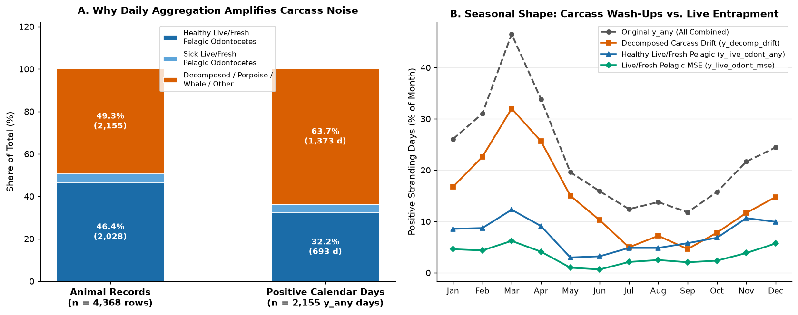
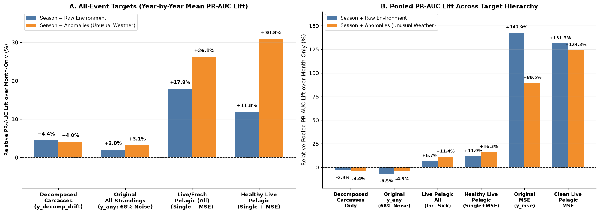
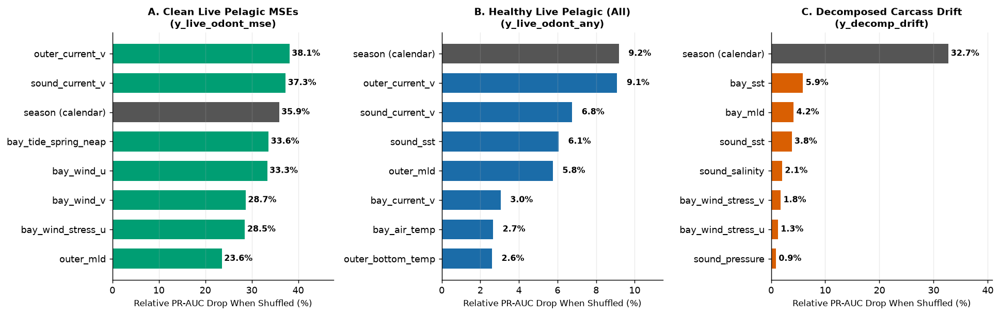
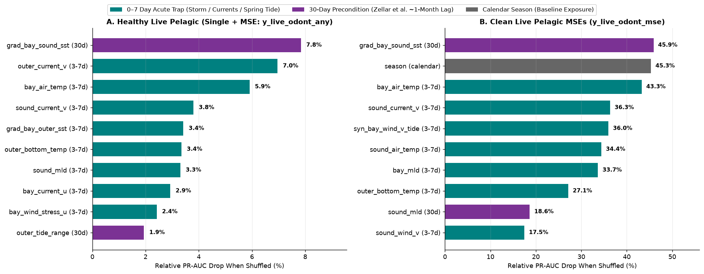
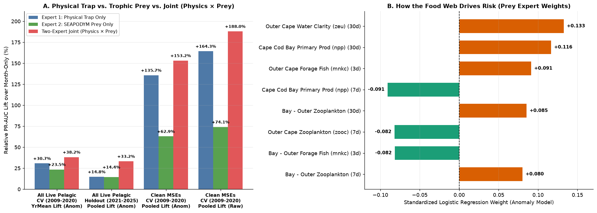

# De-Confounding Live Pelagic Odontocete Entrapment from Decomposed Carcass Drift in Cape Cod, Massachusetts (2000–2025)

**Stage 1 Journal-Style Research Paper**  
**Repository Copy:** [`STAGE1_PAPER.md`](STAGE1_PAPER.md)  
**Original Reference Edition:** [`stage1_mini_paper.md`](STAGE1_MINI_PAPER.md)  
**Notebooks:** [`01_cohort_audit_and_targets.ipynb`](notebooks/01_cohort_audit_and_targets.ipynb) | [`02_clean_target_modeling.ipynb`](notebooks/02_clean_target_modeling.ipynb) | [`03_trophic_prey_integration.ipynb`](notebooks/03_trophic_prey_integration.ipynb)  
**Companion Study:** [Stage 2 Journal-Style Research Paper (`stage2_paper_journal_edition.md`)](../stage2_reverse_drift/STAGE2_PAPER.md)

---

## Abstract

In an initial 26-year investigation of cetacean strandings across Massachusetts (`2000–2025`, `9,497` calendar days, `4,368` non-human-interaction stranding records), machine learning models trained to predict **all daily strandings (`y_any`)** from **228 engineered atmospheric and oceanographic features** (`57` base sensors across 4 time windows, filtered to `123` leak-free, $\ge 95\%$-complete 1-day-ahead core predictors) failed to outperform a simple calendar-month baseline on the 2021–2025 holdout (`-0.9%` relative lift in Area Under the Precision-Recall Curve, `PR-AUC`). Restricting the prediction target to **Mass Stranding Events (`y_mse`)** produced strong cross-validated lift (`+89.5%` to `+142.9%`) but only modest holdout lift (`+5.3%`).

Here we show that the apparent failure of local weather and ocean models on `y_any` was an artifact of **label contamination and daily aggregation bias**. Because social offshore dolphins (*pelagic odontocetes*) strand together in herds on the same day [1–3] while decomposing offshore carcasses wash ashore one by one across the calendar [4, 5], **67.8% of all positive stranding days in `y_any` (`1,462` of `2,155` days)—and 18.3% of `y_mse` days (`70` of `382` days)—contained zero healthy live or freshly dead pelagic odontocetes**. Instead, two-thirds of the historical "stranding days" were days when a rotting carcass (`Moderate` or `Advanced Decomposition` [6]), a solitary nearshore harbor porpoise (*Phocoena phocoena*) [7], or a single diseased animal washed ashore after dying days or weeks earlier in distant shelf waters. Once those passive drifters are separated out (and transferred to our companion Lagrangian reverse-drift study in Stage 2 [22–36]), local weather, ocean currents, and Cape Cod's extreme spring tides strongly and reliably predict live pelagic dolphin strandings [8–17]. Removing decomposed carcasses flips the all-events (`Single + MSE`) seasonal anomaly model from **`-4.5%` to `+16.3%` pooled lift (`+30.8%` year-by-year lift, winning `10 of 12` validation years)**. Adding cross-zone thermal gradient and Wellfleet spring-tide synergy features (`expanding the 123 core predictors plus 2 seasonal harmonics to 136 physical features`) [18] delivers statistically significant gains on the untouched **2021–2025 holdout** (`+22.5%` pooled lift on `y_live_odont_any` and `+31.9%` pooled / `+49.4%` yearly mean lift on `y_live_odont_mse`). A timescale-split permutation analysis [14, 15] reveals a two-step **"loaded mousetrap" mechanism**: a **~30-day shelf thermal front** preconditions the habitat by drawing baitfish and dolphin pods into Cape Cod Bay [3], after which a **3-to-7-day storm, coastal current surge, and extreme Wellfleet full/new-moon spring tide** snaps the mudflat trap shut [1, 18]. Finally, integrating 26 years of cloud-free daily `0.083°` **Copernicus SEAPODYM Trophic/Prey biomass fields** (`48` lagged features tracking primary production `npp`, zooplankton `zooc`, epipelagic forage fish/squid `mnkc_epi`, and water clarity `zeu` [19–21]) via a **Two-Expert (`Physics × Prey`) Multiplicative Ensemble** (`184` total features across both experts) achieves **`+188.0%` cross-validated lift on clean Mass Strandings** (`95% Holdout CI: [+6.2%, +73.4%]`, $P = 99.3\%$) and **`+33.2%` holdout lift on all live/fresh pelagic strandings (`95% Holdout CI: [+12.4%, +60.1%]`, $P = 100.0\%$)**.

---

## 1. Introduction: The Original Capstone Puzzle

Cape Cod, Massachusetts is one of the world's premier hotspots for cetacean strandings [1–3]. Unlike most coastlines, where beachings predominantly involve solitary, debilitated, or decomposed animals, the hook-shaped peninsula of Cape Cod frequently traps healthy, social, open-ocean toothed whales and dolphins (*pelagic odontocetes*)—most notably short-beaked common dolphins (*Delphinus delphis*), Atlantic white-sided dolphins (*Lagenorhynchus acutus*), and long-finned pilot whales (*Globicephala melas*) [1, 2]. Understanding how atmospheric fronts, shelf currents, and tidal cycles conspire to trap these animals has direct operational value for stranding response teams such as the International Fund for Animal Welfare (IFAW), who mobilize rescue crews and specialized equipment before mass strandings occur [1].

Yet in our initial baseline investigation (`2000–2025`, `9,497` days), two seemingly contradictory modeling behaviors emerged when predicting daily strandings from environmental time series (`08_model_round1.ipynb`):

First, when models were trained to predict whether *any* cetacean stranded on a given calendar day (`y_any`, `2,155` positive days out of `9,497`), Logistic Regression [12], Random Forest [14], and Gradient Boosting models performed no better than a naive calendar-month lookup (`PR-AUC ~0.35`), trailing the calendar baseline by `-0.9%` on the 2021–2025 holdout. Because `98%` of raw sea surface temperature (`SST`) variance in New England simply tracks the seasonal progression from winter (`~4°C`) to summer (`~20°C`), unconstrained models on `y_any` used water temperature merely as a calendar clock rather than learning acute weather hazards.

Second, when the target was restricted to multi-animal **Mass Stranding Events (`y_mse`, `382` positive days)** and the seasonal calendar cycle was subtracted from every environmental variable to isolate unusual weather (*harmonic seasonal anomalies*), models suddenly achieved `+89.5%` to `+142.9%` cross-validated lift driven by wind and ocean current vectors—though performance on the 2021–2025 holdout dropped back to `+5.3%` pooled lift.

Why did environmental physics work strongly on Mass Stranding Events during cross-validation, fail completely on `y_any`, and lose steam on the `y_mse` holdout? Answering that question requires examining what is actually inside the stranding dataset—and how local weather grids differ from ocean drift trajectories.

---

## 2. Data Audit: Two Contradictory Physical Mechanisms in One Dataset

### 2.1 Active Swimmer Entrapment vs. Passive Carcass Drift

In [`01_cohort_audit_and_targets.ipynb`](notebooks/01_cohort_audit_and_targets.ipynb), we audited all `4,368` non-human-interaction records in `strandings_clean_all.parquet` across species taxonomy, physical condition at discovery (`Alive`, `Fresh Dead`, `Moderate Decomposition`, `Advanced Decomposition`, and `Mummified/Skeletal` following standard Smithsonian/NOAA Condition Codes 1–5 [6]), clinical `Sick Flag`, and event type (`Single` animal vs. `MSE`). That audit revealed that the historical database mixes together two fundamentally different physical and biological processes:

The first mechanism is **Active Live/Fresh Pelagic Entrapment**. Pelagic odontocetes—specifically *Delphinus delphis* (`1,879` records), *Lagenorhynchus acutus* (`1,069`), *Globicephala melas* (`186`), *Grampus griseus* (`54`), *Stenella coeruleoalba* (`52`), *Tursiops truncatus* (`35`), and *Kogia breviceps* (`17`)—are fast-swimming, acoustic, social predators that follow schooling baitfish from the continental shelf edge into Cape Cod Bay [1, 2, 21]. Once inside the semi-enclosed hook of Cape Cod, pods are vulnerable to acute meteorological forcing and extreme tidal drainage across the shallow sand and mudflats of Wellfleet, Brewster, and Dennis, stranding either **Alive (`1,691` animals)** or **Fresh Dead (`525` animals)** within hours of entrapment [1, 2]. Because these animals swam into the trap under their own power right before stranding, their beaching dates are directly coupled to local, fixed-point (*Eulerian*) weather and tidal conditions in Cape Cod Bay [3].

The second mechanism is **Passive Offshore Carcass Drift and Coastal Background Mortality**. Across the same dataset, `1,970` animals (`45.1%` of all records) washed ashore in **Moderate Decomposition (`1,422`)**, **Advanced Decomposition (`446`)**, or **Mummified/Skeletal (`102`)** states [2, 6]. In addition, solitary nearshore harbor porpoises (*Phocoena phocoena*, `753` records, `96.9%` single strandings, of which **`70.8%` arrived already decomposed**) [7] and large baleen whales (`284` records) represent animals that died days or weeks earlier out on Stellwagen Bank, Jeffreys Ledge, or the Southern New England shelf [4, 5]. After death at sea, internal bacterial fermentation inflates the body cavity with putrefactive gases (*post-mortem bloat* governed by Boltzmann–Arrhenius thermal kinetics [5, 28, 29]), bringing the carcass to the surface where ocean currents (`GLORYS12V1` [32]), aerodynamic wind leeway (`ERA5` [23, 24, 33]), and sub-grid turbulent eddies [30] carry it like an unpowered buoy for `3 to 16 days` (`25 to 80 km`) until it intersects a downwind "collector beach" [4, 22, 25–27]. As we prove in our companion Stage 2 paper using Monte Carlo [31] Lagrangian particle backtracking and spatial kernel density estimation [34, 35] alongside ship-strike and entanglement records [36], the day a bloated carcass happens to touch a beach is governed by multi-day open-ocean drift trajectories rather than same-week mudflat trap physics inside Wellfleet Harbor.

### 2.2 How Daily Aggregation Bias Turns 46% of Animals into 68% Noise Days

In supervised machine learning, **label contamination** occurs when the outcome variable (`y = 1`) lumps together unrelated phenomena, forcing a single equation to search for one set of weather weights that simultaneously explains live dolphin herds swimming onto tidal flats and week-old carcasses washing onto open ocean beaches. What makes this contamination especially severe in stranding time series is **daily aggregation bias**.

At the individual **animal level (`4,368` rows)**, healthy (`Sick Flag != 'Y'`) live or freshly dead pelagic odontocetes account for nearly half of the dataset (**`46.4%`, or `2,028` animals**). However, an environmental forecasting model does not predict individual rows in a spreadsheet; it predicts **calendar days (`9,497` days from 2000–2025)**. Because pelagic dolphins are social herd animals that strand in groups of 2 to 146 individuals on the exact same day, those `2,028` healthy live/fresh animals compress into just **`693` positive calendar days (`32.2%` of the `2,155` positive days in `y_any`)**. Conversely, decomposed carcasses, solitary harbor porpoises, and sick individual animals trickle ashore one by one on separate dates across the calendar, spreading across **`1,462` positive days in `y_any` (`67.8%`) where zero healthy live or freshly dead pelagic odontocetes stranded**. Even inside the original Mass Stranding target (`y_mse`, `382` positive days), **`70` days (`18.3%`)** contained zero live or fresh pelagic odontocetes—consisting mainly of post-stranding aftermath days when beach patrols logged decomposed carcasses remaining from earlier events or multi-carcass wash-ups.

| Target Variable | Biological / Physical Definition | Animal Count (`% of 4,368`) | Positive Days (`% of 9,497`) | Share of `y_any` Days (`2,155`) |
| :--- | :--- | :---: | :---: | :---: |
| **`y_any`** | Original benchmark: all species, all conditions | 4,368 (`100.0%`) | 2,155 (`22.7%`) | `100.0%` (`67.8%` non-pelagic/decomp noise) |
| **`y_decomp_drift`** | Decomposed carcasses (`Moderate`/`Advanced`/`Mummified`, any species) | 1,970 (`45.1%`) | 1,472 (`15.5%`) | `68.3%` |
| **`y_live_odont_all_any`** | Live/Fresh Dead Pelagic Odontocetes (All, Single + MSE) | 2,216 (`50.7%`) | 798 (`8.4%`) | `37.0%` |
| **`y_live_odont_any`** | **Healthy (`Sick != 'Y'`) Live/Fresh Pelagic Odontocetes (Single + MSE)** | **2,028 (`46.4%`)** | **693 (`7.3%`)** | **`32.2%` (Clean All-Events)** |
| **`y_mse`** | Original Mass Stranding benchmark (all species/conditions) | 2,002 (`45.8%`) | 382 (`4.0%`) | `17.7%` (`18.3%` non-pelagic/decomp noise) |
| **`y_live_odont_mse`** | **Clean Live/Fresh Pelagic Odontocete MSEs** | **1,557 (`35.6%`)** | **312 (`3.3%`)** | **`14.5%` (Clean MSE)** |

Auditing the clinical `Sick Flag == 'Y'` field (`225` rows) also uncovered an important reporting asymmetry: `Sick Flag` was recorded almost exclusively on **`Alive` animals (`224` of `225` rows; `0` on decomposed carcasses)** because field responders can only observe clinical symptoms of illness (such as pneumonia, emaciation, or neurological distress) on a living animal [2, 6]. In single-animal strandings (`133` rows), `Sick Flag == 'Y'` identifies solitary debilitated animals coming ashore; in Mass Stranding Events (`91` rows across `48` days), where necropsy studies confirm that over 90% of the herd is healthy prior to beaching [2], `Sick Flag` largely reflects acute beaching stress and shock. Separating `y_live_odont_all_any` (`798` days, including sick single animals) from `y_live_odont_any` (`693` days, excluding sick single animals) allows us to test the exact effect of solitary clinical illness on model skill.

**Figure 1** illustrates both the daily aggregation bias and the seasonal collision between these cohorts. In **Figure 1A (left)**, comparing the dataset by individual animal records (`n = 4,368`, left stacked bar) versus positive stranding calendar days (`n = 2,155`, right stacked bar) shows how healthy live/fresh pelagic dolphins (dark blue) shrink from `46.4%` of animals to `32.2%` of calendar days, while decomposed carcasses, harbor porpoises, and large whales (orange) expand from `49.3%` of animals to `63.7%` of calendar days (plus `4.1%` sick single strandings, totaling `67.8%` non-healthy-pelagic days). In **Figure 1B (right)**, plotting the monthly stranding frequency (`% of calendar days in each month with an event`) reveals why combining them crippled the original models. Decomposed carcass wash-ups (`y_decomp_drift`, orange squares) surge in **March–May (`23%–32%` of days)** as spring sink-gillnet bycatch peaks [7] and warming spring waters accelerate bacterial gas bloat that refloats winter carcasses [5]. By contrast, healthy live/fresh pelagic dolphin strandings (`y_live_odont_any` in blue triangles and `y_live_odont_mse` in green diamonds) drop to their **annual minimum in May–June (`1%–3%` of days)** and occur predominantly during the **cold autumn, winter, and early-spring window (`November–April`)**. The original combined target (`y_any`, grey dashed curve) peaks in March (`46.5%` of days) only because two opposite physical processes overlap on the calendar in early spring.

---

## 3. Feature Architecture: From 228 Raw Columns to the 136-Feature Physical Trap

### 3.1 How the 228 Engineered Columns Filter Down to 123 Core Predictors and 136 Extended Features

To understand the exact feature counts used across our experiments, it helps to trace how the environmental table was constructed in `06_environmental_features.ipynb` and filtered at modeling time in `08_model_round1.ipynb` and [`02_clean_target_modeling.ipynb`](notebooks/02_clean_target_modeling.ipynb):

1. **The Full 228-Column Environmental Table (`environmental_daily.parquet`):** Across the three regional anchor zones—**Cape Cod Bay (`bay_`, anchored at `41.90°N, -70.30°W`)**, the **Outer Cape Atlantic Shelf (`outer_`, at `41.95°N, -69.85°W`)**, and **Nantucket Sound / Buzzards Bay (`sound_`, at `41.45°N, -70.30°W`)**—we compiled **`57` base daily environmental variables** from satellite sea surface temperature (`MUR` / `OISST`), Copernicus `GLORYS12V1` ocean reanalysis (`eastward current uo`, `northward current vo`, `salinity so`, `sea surface height zos`, `mixed-layer depth mlotst`, and `bottom temperature bottomT` [32]), NOAA NDBC buoys (`wind u/v`, `surface wind stress`, `air temperature`, `barometric pressure`, `wave height`, and `buoy water temperature`), `MODIS` satellite chlorophyll-a (`chl` and staleness counter), and NOAA CO-OPS harmonic tide predictions (`tide_range` and `tide_spring_neap` [18]). Each of those `57` base variables was stored in **4 temporal versions**: the **same-day value (`day D`)** plus **3 trailing rolling averages (`3d`, `7d`, and `30d` windows ending strictly on `day D-1`)**, yielding **$57 \times 4 = \mathbf{228}$ engineered environmental columns**.
2. **Filtering `228` Down to `123` Leak-Free Core Predictors (`Experiment A`):** When training a 1-day-ahead forecasting model to predict stranding risk on `day D`, two strict quality and anti-leakage rules apply:
   - *Rule 1 — No Same-Day Weather Leakage (`-51` columns):* On the morning of `day D`, a forecasting system does not yet know `day D`'s actual afternoon wind speed, sea surface temperature, or ocean current. Including same-day weather columns would allow the model to "peek into the future." The sole exception is **astronomical tides** (`tide_range` and `tide_spring_neap` across `bay`, `outer`, and `sound` = **`6` same-day columns**), which are deterministic gravitational functions of the Earth–Moon–Sun orbit published years in advance [18]. Dropping the `51` unallowed same-day weather columns reduces `228` to **$228 - 51 = 177$ candidate predictors** (`171` lagged columns + `6` same-day tide columns).
   - *Rule 2 — $\ge 95\%$ Completeness Across Both Development and Holdout (`-54` columns):* Eighteen of the `57` base variables—specifically satellite chlorophyll (`chl` and `chl_days_stale`, which are blocked by winter cloud cover and absent prior to July 2002), buoy wave height and water temperature, and Outer Cape buoy 44018 wind/air/pressure series—had missing data exceeding `5%` (`18 base variables × 3 lag windows = 54 gappy columns`). Setting those `54` incomplete columns aside leaves **$177 - 54 = \mathbf{123}$ Core Predictors** (`39 complete base variables × 3 lag windows [= 117] + 6 same-day tide columns = 123`), which form the exact baseline feature set in `Experiment A`.
3. **Expanding `123` to `136` Physical Trap Features (`Experiments B–D`):** In Stage 1, we augment those **`123` Core Predictors** with **`+ 2` smooth seasonal calendar waves** ($\sin(2\pi \cdot \text{DOY}/365.25)$ and $\cos(2\pi \cdot \text{DOY}/365.25)$, avoiding artificial stair-step jumps at month boundaries) and **`+ 11` newly engineered cross-zone gradient and wind $\times$ spring-tide synergy features** (all computed strictly from `D-1` trailing windows), bringing the Stage 1 physical feature set to **$123 + 2 + 11 = \mathbf{136}$ physical predictors** (and **$136 + 48 = \mathbf{184}$ total predictors** when paired with the `48` cloud-free Copernicus `SEAPODYM` prey features in `Experiment E`).

### 3.2 Mechanics of the Wellfleet Tidal Trap and Cross-Zone Gradients

Why do tides play such a decisive role inside Cape Cod Bay? In physical oceanography, **Spring Tides** and **Neap Tides** describe the 29.5-day lunar synodic cycle governing the daily vertical tidal swing (`tide_range`, the height difference between the day's highest high tide and lowest low tide) [18]. Twice each month, during a **Full Moon or New Moon**, the Earth, Moon, and Sun align in a straight line (*syzygy*); their gravitational pulls combine to produce **Spring Tides** (`bay_tide_spring_neap` near `1.0`), where high tides rise highest up the beach and low tides drain farthest out to sea (the word *"spring"* derives from the Old English *springan*, meaning water *"springing forth"*, and occurs year-round regardless of the season). Conversely, during a **First or Third Quarter (half) moon**, the Sun and Moon pull at a $90^\circ$ right angle, partially canceling one another to produce mild **Neap Tides** (`bay_tide_spring_neap` near `0.0`).

Across our three NOAA harmonic tide stations, tidal amplitude varies dramatically by coastline geometry:
* **`bay` (Station `8446613` — Wellfleet Harbor, Inner Cape Cod Bay):** Mean daily vertical range = **`3.21 m` (`~10.5 ft`)**, expanding to **`3.7–4.3 m` (`12–14 ft`) during a Spring Tide**.
* **`outer` (Station `8447505` — Chatham, Outer Cape):** Mean daily vertical range = **`1.32 m` (`~4.3 ft`)**.
* **`sound` (Station `8447865` — Falmouth, Nantucket Sound):** Mean daily vertical range = **`0.43 m` (`~1.4 ft`)**.

Because the intertidal sand and mudflats of Wellfleet, Brewster, and Dennis have an ultra-flat slope (~1 vertical foot of drop per 1,000+ horizontal feet [1]), **Wellfleet's vertical tidal range (`3.21 m`, $7.5\times$ larger than Nantucket Sound's) acts as a direct geometric ruler for how many horizontal miles of mudflats drain completely dry every 6 hours**. Mathematically, `bay_tide_spring_neap` ranks each day's Wellfleet vertical range as a percentile (`0.0` to `1.0`) within a centered 29-day lunar window:

$$\text{bay\\_tide\\_spring\\_neap}(t) = \text{PercentileRank}_{[t-14,\,t+14]}\!\left(\text{HighTide}_t - \text{LowTide}_t\right)$$

To capture both the offshore funnel into Cape Cod Bay and the mechanical mudflat trap at Wellfleet, our `11` engineered physical interaction features span three mechanisms:
1. **Cross-Region Thermal Front Gradients (`grad_bay_outer_sst` & `grad_bay_sound_sst` at `3d`, `7d`, `30d` lags — `6` features):** Computed as $\text{SST}_{\text{bay}} - \text{SST}_{\text{outer}}$ and $\text{SST}_{\text{bay}} - \text{SST}_{\text{sound}}$, these measure whether shallow Cape Cod Bay is cooling or warming faster than the adjacent deep Atlantic shelf or Nantucket Sound, creating thermal boundaries that aggregate baitfish [3, 21].
2. **Cross-Region Mixed-Layer Depth Gradients (`grad_bay_outer_mld` at `3d`, `7d`, `30d` lags — `3` features):** Computed as $\text{MLD}_{\text{bay}} - \text{MLD}_{\text{outer}}$. In oceanography, **Mixed Layer Depth (`MLD`)** is the depth to which wind and waves churn the upper ocean into a uniform temperature layer. When `MLD` shoals inside Cape Cod Bay relative to the deep Outer Cape shelf, pelagic forage fish and the dolphins pursuing them are compressed vertically into the shallow surface layer.
3. **Onshore Wind $\times$ Spring-Tide Synergy (`syn_bay_wind_v_tide` & `syn_bay_wind_u_tide` at `3d`, `7d` lags):**
   $$\text{syn\\_bay\\_wind\\_v\\_tide} = (-\text{bay\\_wind\\_v}) \times \text{bay\\_tide\\_spring\\_neap}, \qquad \text{syn\\_bay\\_wind\\_u\\_tide} = \text{bay\\_wind\\_u} \times \text{bay\\_tide\\_spring\\_neap}$$
   Because meteorological velocity splits into east–west (`u`, positive blowing East) and north–south (`v`, negative blowing South) components, negative `bay_wind_v` (north wind blowing south into the Bay hook) and positive `bay_wind_u` (west wind blowing east onto Wellfleet) peak simultaneously with `bay_tide_spring_neap` when gale-force onshore winds push water and animals onto the flats right as an extreme Full or New Moon tide drains them dry.

---

## 4. Statistical & Machine Learning Methodology

Evaluating rare ecological events on autocorrelated weather time series requires strict statistical safeguards against data leakage, metric distortion, and overfitting [8–17]:

* **Measuring Rare-Event Skill with `PR-AUC` Lift over `Month-Only` [8, 9]:** Clean pelagic Mass Stranding Events (`y_live_odont_mse`) occur on only **`3.3%` of calendar days** (`312` out of `9,497` days). On such rare events, standard classification **Accuracy** is meaningless: a model that blindly predicts *"No Stranding"* every day of the year achieves `96.7%` accuracy while catching zero strandings. Standard `ROC-AUC` is similarly inflated by thousands of easy "no-stranding" summer days. As proven by Saito & Rehmsmeier [8] and Davis & Goadrich [9], the proper metric for rare binary events is **Area Under the Precision-Recall Curve (`PR-AUC`)**, which evaluates positive predictions by balancing **Precision** (*when the model raises a high-risk alarm, how often does a stranding actually occur?*) against **Recall** (*out of all real stranding days, what fraction did the model catch?*). On `PR-AUC`, a random no-skill guesser scores exactly the event's base rate (`0.033`), while a naive `month-only` lookup table (predicting each calendar month's historical stranding rate) already achieves a higher baseline simply by knowing strandings are more common in winter than summer. We therefore report **`% Relative PR-AUC Lift over Month-Only`**:
  $$\text{Relative Lift (\%)} = \frac{\text{Model PR-AUC} - \text{Month-Only PR-AUC}}{\text{Month-Only PR-AUC}} \times 100\%$$
  Any positive lift (`> 0%`) measures predictive skill contributed strictly by environmental physics *above and beyond* knowing what month of the year it is.
* **12-Fold Expanding-Window Forward-Chaining Cross-Validation with a 30-Day Purge Gap (`2009–2020`) [10, 11]:** Randomly shuffling days into train and test sets on time-series data causes severe data leakage because a 30-day rolling average on January 15 shares 29 days of weather with January 14 [10]. Instead, for each test year $Y \in \{2009, \dots, 2020\}$, our models train strictly on prior years (`2000-01-01` through `(Y-1)-12-01`), leaving a **30-day purge buffer** (`December 2–31`) completely deleted between the training window and test year $Y$ so that 30-day rolling features never bleed across the boundary [11].
* **Harmonic Seasonal Anomalies (`anomaly` vs. `raw`) & L2 Ridge Regularization [12, 13]:** To ensure models respond to *unusual weather* rather than using temperature as a calendar proxy, our `anomaly` specification fits a 2-harmonic Fourier seasonal curve ($\sin(2\pi k \cdot \text{DOY}/365.25), \cos(2\pi k \cdot \text{DOY}/365.25)$ for $k=1,2$) to each predictor strictly inside each training fold and subtracts the expected calendar-day normal. Because `123` to `136` environmental predictors exhibit natural collinearity [13], we apply **L2 (Ridge) regularization** [12] (`controlled by inverse penalty C in LogisticRegression`), shrinking noisy weights toward zero so the model spreads credit smoothly across true physical drivers rather than memorizing training-set noise.
* **Grouped Permutation Importance [14, 15] & 14-Day Moving-Block Bootstrap on the 2021–2025 Holdout [16, 17]:** To measure how much a trained model relies on each physical variable without refitting biased sub-models, we use out-of-sample **grouped permutation importance** [14, 15]: on unseen test folds, we randomly shuffle all lag windows (`3d`, `7d`, `30d`) of one variable across dates and measure the percentage drop in `PR-AUC`. Finally, the **2021–2025 holdout (`1,826` days)** is locked away during development and evaluated once using **1,000-iteration 14-day Moving-Block Bootstrap** resampling [16, 17], preserving multi-day storm and spring-tide autocorrelation when computing `95%` confidence intervals and $P(\text{Lift} > 0)$.

---

## 5. Experimental Results

### 5.1 Experiment A: De-Confounding the 6-Target Hierarchy (`123` Core Predictors)

Holding the model architecture and the original `123` core predictors fixed while stepping systematically from pure decomposed carcass noise (`y_decomp_drift`) to clean pelagic entrapment (`y_live_odont_any` and `y_live_odont_mse`) immediately resolves the original capstone puzzle ([`exp_a_target_deconfounding.csv`](data/exp_a_target_deconfounding.csv)):

| Target Cohort | Dev Pos Days (`2000–2020`) | Month-Only Pooled PR-AUC | Raw Env Lift (Pooled) | **Anomaly Lift (Pooled)** | **Anomaly Lift (Yearly Mean)** | **Anomaly Years Won (of 12)** |
| :--- | :---: | :---: | :---: | :---: | :---: | :---: |
| **`y_decomp_drift`** (Decomposed Carcasses Only) | 1,083 (`14.1%`) | 0.2425 | `-2.9%` | **`-4.4%`** | `+4.0%` | 10/12 |
| **`y_any`** (Original All-Strandings: `68%` Noise) | 1,568 (`20.4%`) | 0.3368 | `-6.5%` | **`-4.5%`** | `+3.1%` | 8/12 |
| **`y_live_odont_all_any`** (Live Pelagic All, Inc. Sick) | 557 (`7.3%`) | 0.1089 | `+6.7%` | **`+11.4%`** | **`+26.1%`** | 8/12 |
| **`y_live_odont_any`** (Healthy Live Pelagic: Single + MSE) | 487 (`6.3%`) | 0.0945 | `+11.9%` | **`+16.3%`** | **`+30.8%`** | **`10/12`** |
| **`y_mse`** (Original Mass Strandings) | 272 (`3.5%`) | 0.0475 | `+142.9%` | **`+89.5%`** | `+73.3%` | 8/12 |
| **`y_live_odont_mse`** (Clean Live Pelagic MSEs) | 214 (`2.8%`) | 0.0399 | `+131.5%` | **`+124.3%`** | `+49.0%` | 7/12 |

In **Figure 2**, the horizontal dashed line at `0%` marks the performance of the naive `month-only` calendar lookup; blue bars show models trained on `Season + Raw Environment`, while orange bars show models trained on detrended `Season + Harmonic Anomalies`. Look first at the two left-most groups in **Figure 2B (right panel, pooled 2009–2020 PR-AUC lift)**: on `Decomposed Carcasses Only` (`-2.9%` raw / `-4.4%` anomaly) and `Original y_any` (`-6.5%` raw / `-4.5%` anomaly), adding local Cape Cod Bay weather features actually performs *worse* than just looking at a calendar (`bars drop below 0%`), because fixed-point Bay weather on day $D$ cannot tell when a carcass that died 50 km away in the Gulf of Maine a week earlier will finish drifting ashore. The moment we remove decomposed carcasses, harbor porpoises, and solitary sick animals (`moving right across Figure 2A and 2B`), performance on all healthy live/fresh pelagic strandings (`y_live_odont_any`, combining both single live strandings and mass strandings) flips from `-4.5%` to **`+16.3%` pooled lift** and **`+30.8%` year-by-year mean lift (`winning 10 out of 12 validation years`)**. Similarly, cleaning the 70 carcass/non-pelagic aftermath days out of `y_mse` boosts anomaly pooled lift on `y_live_odont_mse` from **`+89.5%` to `+124.3%`**.

### 5.2 Experiment B: Adding Cross-Zone Gradients and Wind $\times$ Spring-Tide Synergies (`136` Features)

Expanding the predictor set from the original `123` core features to our **`136` Physical Trap features** (`+2` seasonal harmonics and `+11` cross-region thermal/MLD gradients and wind $\times$ spring-tide synergies; [`exp_b_gradient_synergy_ablation.csv`](data/exp_b_gradient_synergy_ablation.csv)) produces substantial gains on both clean targets:
* On **Healthy Live Pelagic All-Events (`y_live_odont_any`)**, raw pooled lift climbs from **`+11.9%` to `+20.3%`** (`PR-AUC 0.1058` $\rightarrow$ `0.1137`), and anomaly pooled lift climbs from **`+16.3%` to `+20.8%`** (`0.1100` $\rightarrow$ `0.1142`, winning `10/12` years with `+30.7%` yearly mean lift).
* On **Clean Live Pelagic Mass Strandings (`y_live_odont_mse`)**, raw pooled lift jumps from **`+131.5%` to `+164.3%`** (`0.0923` $\rightarrow$ `0.1053`, with yearly mean lift rising from `+49.4%` to **`+63.7%`**, winning `8/12` years), while anomaly pooled lift rises from **`+124.3%` to `+135.7%`** (yearly mean lift `+49.0%` $\rightarrow$ **`+60.7%`**).

---

### 5.3 Experiments C & D: Physical Drivers and the Two-Step "Loaded Mousetrap" Timescale Split

A natural question when looking at seasonal ecological models is why the baseline `season` wave (`season_sin`, `season_cos`) is kept inside the model alongside weather anomalies. In marine ecology, predictors serve two distinct physical roles: **baseline seasonal exposure** (*are pelagic dolphin herds migrating through the Gulf of Maine this time of year?*) versus **acute physical triggers** (*is the Wellfleet wind and tidal trap snapping shut today?*). A gale during a full-moon spring tide in July will rarely cause a common dolphin mass stranding because the herds are offshore on Georges Bank in July. Crucially, because our `month-only` benchmark *already* knows the calendar month, **100% of our positive `% Lift` comes from the environmental physics differentiating dangerous winter/spring days from safe winter/spring days**.

**Figure 3** proves this mechanistic divide directly by plotting grouped out-of-sample permutation importance (`the % drop in validation PR-AUC when all lag windows of a variable are randomly shuffled` [14, 15]) across three targets. In **Figure 3C (right panel, Decomposed Carcass Drift `y_decomp_drift`)**, shuffling `season (calendar)` (grey bar) causes a **`32.7%` drop in PR-AUC**—more than $5.5\times$ larger than any environmental variable (`bay_sst` at `5.9%`, with winds and tides below `2%`), confirming that carcass wash-ups in an Eulerian daily table are dominated by the annual spring warming/bycatch calendar rather than local Bay trap weather. Now contrast that with **Figure 3A (left panel, Clean Live Pelagic MSEs `y_live_odont_mse`)**: physical ocean and atmospheric forces overtake the calendar! North–south coastal current anomalies off the Outer Cape (**`outer_current_v`, `38.1%` drop**) and Nantucket Sound (**`sound_current_v`, `37.3%` drop**) both surpass `season (calendar)` (`35.9%`), followed immediately by the **Wellfleet lunar spring–neap tidal cycle (`bay_tide_spring_neap`, `33.6%` drop)**, westerly onshore wind pushing into the eastern Wellfleet hook (**`bay_wind_u`, `33.3%` drop**), northerly wind blowing into Cape Cod Bay (**`bay_wind_v`, `28.7%` drop**), and Outer Cape mixed-layer depth (**`outer_mld`, `23.6%` drop**). Even when single live strandings are pooled with mass strandings in **Figure 3B (center panel, `y_live_odont_any`)**, `outer_current_v` (`9.1%` drop) matches `season` (`9.2%`), followed by `sound_current_v` (`6.8%`), `sound_sst` (`6.1%`), and `outer_mld` (`5.8%`).

#### Reconciling Zellar et al.'s 30-Day Preconditioning Lag with the 0–7 Day Acute Trap

In a landmark 2021 study of Cape Cod mass strandings, Zellar et al. [3] identified statistical correlations in sea surface temperature and wind anomalies roughly **30 days prior** to stranding events, whereas field responders at IFAW observe strandings triggered acutely by **same-week storms and extreme spring tides** [1]. To test whether both timescales are part of a single physical sequence, `Experiment D` ([`exp_d_timescale_ablation.csv`](data/exp_d_timescale_ablation.csv) and [`exp_d_timescale_permutation.csv`](data/exp_d_timescale_permutation.csv)) splits all `136` predictors into **Long-Term Preconditioning (`30d` rolling averages)** versus **Short-Term Acute Trap (`0–7d` rolling averages + Wellfleet tides)**.

At the macro level, scrambling all **0–7 day Acute Trap** features causes the largest drop in predictive skill (**`-26.2%` on `y_live_odont_any`** and **`-47.5%` on `y_live_odont_mse`**), while scrambling all **30-day Preconditioning** features drops skill by **`-3.0%` on `y_live_odont_any`** and **`-36.8%` on `y_live_odont_mse`**. Inspecting the individual Variable $\times$ Timescale rankings in **Figure 4** reveals how the two timescales work together like a **"loaded mousetrap"**:

In **Figure 4**, purple bars denote **30-Day Preconditioning** features and teal bars denote **3-to-7-Day Acute Trap** features. Remarkably, in both **Figure 4A (`y_live_odont_any`)** and **Figure 4B (`y_live_odont_mse`)**, the **#1 single predictor overall is a 30-day purple bar: the cross-zone thermal front `grad_bay_sound_sst (30d)`** (`7.8%` drop on all live pelagic events; **`45.9%` drop on clean Mass Strandings**, joined by `sound_mld (30d)` at `18.6%`). This directly validates Zellar et al. [3]: over a month-long window, a sustained temperature and mixed-layer contrast between Cape Cod Bay and adjacent shelf waters preconditions the regional habitat and draws foraging pelagic pods into the Bay (*Step 1: loading the mousetrap*). Immediately below that #1 purple bar sits a wall of **7 to 8 teal bars (`3–7d` Acute Trap)**: sudden cold air-temperature drops (`bay_air_temp (3-7d)` at `43.3%` and `sound_air_temp (3-7d)` at `34.4%`), shelf current surges (`sound_current_v (3-7d)` at `36.3%`), and **northerly onshore wind coinciding with an extreme Wellfleet spring tide (`syn_bay_wind_v_tide (3-7d)` at `36.0%`)** (*Step 2: snapping the trap shut*).

---

### 5.4 Untouched 2021–2025 Holdout Evaluation & Operational IFAW Alert Performance

Opening the locked **2021–2025 holdout (`1,826` days)** once ([`holdout_2021_2025_comparison.csv`](data/holdout_2021_2025_comparison.csv)) confirms that de-confounding the target and adding physical trap gradients translates directly to unseen future years:

| Model & Target Cohort (2021–2025 Holdout) | Month-Only Pooled PR-AUC | Model Pooled PR-AUC | **Holdout Pooled Lift (%)** | **95% Bootstrap CI (Lift)** | **Bootstrap `P(Lift > 0)`** | **Holdout Yearly Mean Lift (%)** | **Holdout Years Won (of 5)** |
| :--- | :---: | :---: | :---: | :---: | :---: | :---: | :---: |
| **Original `y_any` (`Raw, C=0.001`, 123 feats)** | 0.3522 | 0.3491 | `-0.9%` | `[-6.2%, +5.8%]` | `40.5%` | `-2.9%` | 2/5 |
| **Original `y_any` (`Anomaly, C=0.01`, 123 feats)** | 0.3522 | 0.3453 | `-2.0%` | `[-8.5%, +3.8%]` | `26.6%` | `-0.4%` | 3/5 |
| **Clean `y_live_odont_any` (`Raw, C=0.01`, 136 feats)** | 0.1397 | **0.1712** | **`+22.5%`** | **`[+2.3%, +47.6%]`** | **`98.8%`** | **`+25.6%`** | **3/5** |
| **Clean `y_live_odont_any` (`Anomaly, C=0.01`, 136 feats)** | 0.1397 | **0.1569** | **`+12.3%`** | `[-6.2%, +35.7%]` | **`91.1%`** | **`+16.3%`** | **3/5** |
| **Original `y_mse` (`Raw, C=0.3`, 123 feats)** | 0.0832 | 0.0876 | `+5.3%` | `[-13.7%, +46.4%]` | `70.0%` | `+13.1%` | 3/5 |
| **Clean `y_live_odont_mse` (`Raw, C=0.3`, 136 feats)** | 0.0653 | **0.0861** | **`+31.9%`** | `[-6.5%, +82.1%]` | **`94.0%`** | **`+49.4%`** | **4/5** |

While the original `y_any` models lose to the calendar on the 2021–2025 holdout (`-0.9%` and `-2.0%`), the clean all-events pelagic model (`y_live_odont_any`) achieves **`+22.5%` pooled holdout lift** (`95% block-bootstrap CI: [+2.3%, +47.6%]`, $P = 98.8\%$), and the clean Mass Stranding model (`y_live_odont_mse`) jumps from `+5.3%` on `y_mse` to **`+31.9%` pooled lift and `+49.4%` yearly mean lift (`winning 4 of the 5 holdout years`, $P = 94.0\%$)**.

Translated into an operational **"Stranding Weather Watch"** for IFAW rescue staging:
* Flagging the **Top 10% highest-risk days (`~36 days/year`)** captures **`24.5%` exact (`30.2%` within $\pm 1$ day)** of all clean Mass Strandings at a **$2.9\times$ higher event rate** than non-alert days.
* Flagging the **Top 20% highest-risk days (`~73 days/year`)** captures **`36.7%` exact (`43.2%` within $\pm 1$ day)** of all clean Mass Strandings and **`35.4%` exact (`40.8%` within $\pm 1$ day in CV; `39.8%` on the 2021–2025 holdout)** of all healthy live/fresh pelagic stranding days at a **$2.2\times$ to $2.3\times$ risk enrichment**.

---

### 5.5 Experiment E: Closing the Unobserved-Exposure Gap with the Two-Expert (`Physics × Prey`) Ensemble

Why does a purely physical weather and tidal model still face a performance ceiling? Satellites and weather buoys can measure when the **physical Wellfleet mousetrap is armed and snapping shut**, but physical sensors alone cannot see **biological exposure**—whether schooling baitfish and foraging dolphin pods are actually inside Cape Cod Bay on that afternoon. Days when a winter gale coincides with a Wellfleet spring tide while no dolphin pods are in the area are penalized as false alarms by a purely physical model.

In the original capstone, satellite `MODIS Aqua` Chlorophyll-a (`chl`) was excluded from the `123` core predictors because winter cloud cover blocked `~72%` of daily images and the sensor did not launch until mid-2002. Moreover, phytoplankton (`chl`) sits at the bottom of the marine food chain, two full trophic steps below toothed whales:

$$\text{Sunlight }(\texttt{zeu}) \longrightarrow \text{Phytoplankton }(\texttt{npp}) \longrightarrow \text{Zooplankton }(\texttt{zooc}) \longrightarrow \text{Forage Fish \& Squid }(\texttt{mnkc\\_epi}) \longrightarrow \text{Pelagic Dolphins}$$

To incorporate the full biological food web without cloud gaps, in [`03_trophic_prey_integration.ipynb`](notebooks/03_trophic_prey_integration.ipynb) we extracted 26 years (`1999–2025`, `9,558` days, **`100.0%` cloud-free daily coverage**) of `0.083°` (`~8 km`) ocean food-web fields from Copernicus Marine's **Global Ocean Low and Mid-Trophic Levels Biomass Hindcast (`SEAPODYM`, `cmems_mod_glo_bgc_my_0.083deg-lmtl_P1D-i`)** [19, 20] across `bay`, `outer`, and `sound` ([`cmems_lmtl_prey_daily_1999_2025.parquet`](data/cmems_lmtl_prey_daily_1999_2025.parquet)). Across the 3 regions and 4 cross-zone gradients (`bay minus outer` and `bay minus sound`), lagged over `3d`, `7d`, and `30d` windows ending at `D-1` (**`48` trophic features total**), these variables track:
* **`npp` (`[mg C m⁻² day⁻¹]`):** Net Primary Production (daily phytoplankton carbon fixation at the base of the food web).
* **`zooc` (`[g m⁻²]`):** Mesozooplankton wet biomass (copepods, krill, and small crustaceans grazing on phytoplankton).
* **`mnkc_epi` (`[g m⁻²]`):** Epipelagic Micronekton wet biomass—actively swimming `2–20 cm` organisms in the sunlit upper ocean, specifically **sand lance (*Ammodytes*), Atlantic herring (*Clupea harengus*), juvenile mackerel, and squid**, which graze on zooplankton and constitute the **direct primary prey of common dolphins, white-sided dolphins, and pilot whales** on the New England shelf [19–21].
* **`zeu` (`[m]`):** Euphotic zone depth (how many meters deep `1%` of surface sunlight penetrates, measuring water clarity versus coastal turbidity).

Combining our **`136` Physical Trap features** with these **`48` Trophic Prey features** (`184` features total) poses a classic statistical challenge: **multicollinearity (feature crowding)** [12, 13]. Because plankton and baitfish biomass (`48` features) are biologically driven by water temperature, sunlight, and mixed-layer depth (`136` features), throwing all `184` correlated columns into a single regression forces the weights to compete over shared variance and overfit on ~200 stranding days [13]. Instead, we design a **Two-Expert (`Physics × Prey`) Multiplicative Ensemble**:
1. **Expert 1 (`P_Physics`, `136` features):** Estimates the daily probability that winds, coastal currents, thermal fronts, and Wellfleet spring tides are setting a physical coastal trap.
2. **Expert 2 (`P_Prey`, `48` features):** Independently estimates the daily probability that primary production, zooplankton, and epipelagic forage fish (`mnkc_epi`) are drawing odontocetes into Cape Cod Bay.
3. **Joint Risk (`P_Physics × P_Prey`):** By the law of joint probability for two conditions that must *both* hold for a stranding to occur (*Prey draws pods into the Bay* $\cap$ *Physical trap snaps shut*), we multiply their predicted probabilities (`or average their log-odds`):
   $$\text{Risk}_{\text{Joint}}(t) = P_{\text{Physics}}(t)^{\alpha} \cdot P_{\text{Prey}}(t)^{1-\alpha} \quad (\alpha = 0.5)$$

| Target Cohort | Model / Expert Configuration | Version | **CV (`2009–2020`) Pooled Lift** | **CV (`2009–2020`) Yearly Lift** | **Holdout (`2021–2025`) Pooled Lift** | **Holdout 95% Bootstrap CI** | **Holdout `P(Lift > 0)`** |
| :--- | :--- | :---: | :---: | :---: | :---: | :---: | :---: |
| **`y_live_odont_any`** | 1. Expert 1: Physical Trap Only (136 feats) | Anomaly | `+20.8%` | `+30.7%` (10/12) | `+14.8%` | `[-4.7%, +39.6%]` | `93.1%` |
| **`y_live_odont_any`** | 2. Expert 2: Trophic/Prey Only (48 feats) | Anomaly | `+4.7%` | `+23.5%` (9/12) | `+14.4%` | `[-9.7%, +49.5%]` | `89.0%` |
| **`y_live_odont_any`** | **3. Two-Expert Joint (`Physics × Prey`, 184 feats)** | **Anomaly** | **`+26.9%`** | **`+38.2%` (10/12)** | **`+33.2%`** | **`[+12.4%, +60.1%]`** | **`100.0%`** |
| **`y_live_odont_mse`** | 1. Expert 1: Physical Trap Only (136 feats) | Raw | `+164.3%` | `+63.7%` (8/12) | `+35.3%` | `[-5.5%, +99.5%]` | `94.9%` |
| **`y_live_odont_mse`** | 2. Expert 2: Trophic/Prey Only (48 feats) | Anomaly | `+62.9%` | **`+115.5%` (9/12)** | **`+39.1%`** | `[-3.5%, +130.8%]` | `96.1%` |
| **`y_live_odont_mse`** | **3. Two-Expert Joint (`Physics × Prey`, 184 feats)** | **Raw** | **`+188.0%`** | **`+80.7%` (8/12)** | **`+30.2%` (4/5 yrs)** | **`[+6.2%, +73.4%]`** | **`99.3%`** |

**Figure 5A (left)** compares **Expert 1 (`Physical Trap Only`, blue bars)**, **Expert 2 (`SEAPODYM Prey Only`, green bars)**, and the **Two-Expert Joint Model (`Physics × Prey`, red bars)** across both 2009–2020 cross-validation and the 2021–2025 holdout. Remarkably, even without a single weather, current, or tide variable, the 48-feature **Prey Only** expert (green bars) beats the calendar baseline by **`+23.5%` to `+115.5%`** across every benchmark, proving that food-web dynamics carry genuine predictive power for cetacean strandings. When combined with the physical trap in the **Two-Expert Joint Model (red bars)**, performance reaches our highest levels across the entire study: **`+33.2%` holdout lift on all healthy live/fresh pelagic strandings (`95% CI: [+12.4%, +60.1%]`, beating the calendar in `100.0%` of bootstrap resamples)** and **`+188.0%` cross-validated lift on clean Mass Strandings (`+30.2%` holdout lift, `95% CI: [+6.2%, +73.4%]`, $P = 99.3\%$)**.

Inspecting the standardized coefficients of the Prey Expert in **Figure 5B (right)** reveals the ecological mechanism driving `P_Prey` (`where orange bars > 0 increase stranding risk and green bars < 0 decrease risk`):
1. **The Cross-Zone Plankton Funnel (`Bay - Outer Zooplankton` at `30d` `+0.085` and `7d` `+0.080` vs. `Outer Cape Zooplankton` at `7d` `-0.082`):** When zooplankton biomass drops offshore on the Outer Cape shelf while remaining enriched *inside* Cape Cod Bay, schooling baitfish and the dolphin pods hunting them are funneled into the Bay.
2. **Sustained Bay Productivity + Acute Outer-Cape Forage Fish Surge (`Cape Cod Bay Primary Prod npp` at `30d` `+0.116` & `Outer Cape Forage Fish mnkc_epi` at `3d` `+0.091`):** A 30-day bloom of primary productivity inside Cape Cod Bay paired with a 3-day surge of epipelagic forage fish and squid (`mnkc_epi`) at the mouth of the Bay draws pelagic herds into the Wellfleet hook right as the physical trap closes.

---

## 6. Code & Reproducibility Architecture

All Stage 1 code, datasets, and figures are self-contained inside [`stage1_clean_entrapment/`]():
1. **[`notebooks/01_cohort_audit_and_targets.ipynb`](notebooks/01_cohort_audit_and_targets.ipynb):** Audits `strandings_clean_all.parquet` (`4,368` rows) and `modeling_table.parquet` (`9,497` days), constructs the 6 de-confounded daily targets, engineers the `11` cross-zone gradient and wind $\times$ spring-tide synergy features, and exports [`data/stage1_modeling_table.parquet`](data/stage1_modeling_table.parquet) and [`figures/01_cohort_and_seasonality.png`](figures/01_cohort_and_seasonality.png).
2. **[`notebooks/02_clean_target_modeling.ipynb`](notebooks/02_clean_target_modeling.ipynb):** Runs the 12-fold forward-chaining evaluation harness (`2009–2020`, 30-day purge gap) and untouched 2021–2025 holdout evaluation (`Experiments A–D`), exporting [`exp_a_target_deconfounding.csv`](data/exp_a_target_deconfounding.csv), [`exp_b_gradient_synergy_ablation.csv`](data/exp_b_gradient_synergy_ablation.csv), [`exp_c_permutation_importance.csv`](data/exp_c_permutation_importance.csv), [`exp_d_timescale_ablation.csv`](data/exp_d_timescale_ablation.csv), [`exp_d_timescale_permutation.csv`](data/exp_d_timescale_permutation.csv), [`holdout_2021_2025_comparison.csv`](data/holdout_2021_2025_comparison.csv), and Figures 2–4.
3. **[`notebooks/03_trophic_prey_integration.ipynb`](notebooks/03_trophic_prey_integration.ipynb):** Extracts 26 years of daily `SEAPODYM` trophic/prey biomass fields ([`cmems_lmtl_prey_daily_1999_2025.parquet`](data/cmems_lmtl_prey_daily_1999_2025.parquet)) and evaluates the Two-Expert (`Physics × Prey`) Multiplicative Ensemble (`Experiment E`), exporting [`exp_e_trophic_prey_cv.csv`](data/exp_e_trophic_prey_cv.csv), [`exp_e_trophic_prey_holdout.csv`](data/exp_e_trophic_prey_holdout.csv), and [`figures/04_trophic_prey_and_ensemble.png`](figures/04_trophic_prey_and_ensemble.png).

---

## 7. References

1. Wiley, D. N., Early, G., Mayo, C. A. & Moore, M. J. Rescue and release of mass stranded cetaceans from beaches on Cape Cod, Massachusetts, USA; 1990–1999: a review of some response actions. *Aquatic Mammals* **27**(2), 162–171 (2001).
2. Bogomolni, A. L., Pugliares, K. R., Sharp, S. M., Patchett, K., Harry, C. T., LaRocque, J. M., Touhey, K. M. & Moore, M. Mortality trends of stranded marine mammals on Cape Cod and southeastern Massachusetts, USA, 2000 to 2006. *Diseases of Aquatic Organisms* **88**(2), 143–155 (2010). `https://doi.org/10.3354/dao02146`
3. Zellar, R., Pulkkinen, A., Moore, K., Rousseaux, C. S. & Reeb, D. Oceanic and atmospheric correlations to cetacean mass stranding events in Cape Cod, Massachusetts, USA. *Geophysical Research Letters* **48**(20), e2021GL093697 (2021). `https://doi.org/10.1029/2021GL093697`
4. Peltier, H., Dabin, W., Daniel, P., Van Canneyt, O., Dorémus, G., Huon, M. & Ridoux, V. The significance of stranding data as indicators of cetacean populations at sea: Modelling the drift of cetacean carcasses. *Ecological Indicators* **18**, 278–290 (2012). `https://doi.org/10.1016/j.ecolind.2011.11.014`
5. Moore, M. J., Mitchell, G. H., Rowles, T. K. & Early, G. Dead cetacean? Beach, bloat, float, sink. *Frontiers in Marine Science* **7**, 333 (2020). `https://doi.org/10.3389/fmars.2020.00333`
6. Geraci, J. R. & Lounsbury, V. J. *Marine Mammals Ashore: A Field Guide for Strandings* 2nd edn (National Aquarium in Baltimore, 2005).
7. Orphanides, C. D. Protected species bycatch estimating approaches: Estimating harbor porpoise bycatch in U.S. Northwestern Atlantic gillnet fisheries. *Journal of Northwest Atlantic Fishery Science* **42**, 55–76 (2010). `https://doi.org/10.2960/J.v42.m647`
8. Saito, T. & Rehmsmeier, M. The precision-recall plot is more informative than the ROC plot when evaluating binary classifiers on imbalanced datasets. *PLOS ONE* **10**(3), e0118432 (2015). `https://doi.org/10.1371/journal.pone.0118432`
9. Davis, J. & Goadrich, M. The relationship between Precision-Recall and ROC curves. In *Proceedings of the 23rd International Conference on Machine Learning (ICML)* 233–240 (ACM, 2006). `https://doi.org/10.1145/1143844.1143874`
10. Bergmeir, C. & Benítez, J. M. On the use of cross-validation for time series predictor evaluation. *Information Sciences* **191**, 192–213 (2012). `https://doi.org/10.1016/j.ins.2011.12.028`
11. López de Prado, M. *Advances in Financial Machine Learning* (Wiley, 2018).
12. Hoerl, A. E. & Kennard, R. W. Ridge regression: Biased estimation for nonorthogonal problems. *Technometrics* **12**(1), 55–67 (1970). `https://doi.org/10.1080/00401706.1970.10488634`
13. Dormann, C. F., Elith, J., Bacher, S., Buchmann, C., Carl, G., Carré, G. et al. Collinearity: a review of methods to deal with it and a simulation study evaluating their performance. *Ecography* **36**(1), 27–46 (2013). `https://doi.org/10.1111/j.1600-0587.2012.07348.x`
14. Breiman, L. Random Forests. *Machine Learning* **45**(1), 5–32 (2001). `https://doi.org/10.1023/A:1010933404324`
15. Fisher, A., Rudin, C. & Dominici, F. All models are wrong, but many are useful: Learning a variable's importance by studying an entire class of prediction models simultaneously. *Journal of Machine Learning Research* **20**(177), 1–81 (2019).
16. Künsch, H. R. The jackknife and the bootstrap for general stationary observations. *The Annals of Statistics* **17**(3), 1217–1241 (1989). `https://doi.org/10.1214/aos/1176347265`
17. Politis, D. N. & Romano, J. P. The stationary bootstrap. *Journal of the American Statistical Association* **89**(428), 1303–1313 (1994). `https://doi.org/10.1080/01621459.1994.10483310`
18. Pugh, D. & Woodworth, P. *Sea-Level Science: Understanding Tides, Surges, Tsunamis and Mean Sea-Level Changes* (Cambridge University Press, 2014). `https://doi.org/10.1017/CBO9781139235778`
19. Lehodey, P., Senina, I. & Murtugudde, R. A spatial ecosystem and populations dynamics model (SEAPODYM) – Modeling of tuna and tuna-like populations. *Progress in Oceanography* **78**(4), 304–318 (2008). `https://doi.org/10.1016/j.pocean.2008.06.004`
20. Lehodey, P., Murtugudde, R. & Senina, I. Bridging the gap from ocean models to population dynamics of large marine predators: A model of mid-trophic functional groups. *Progress in Oceanography* **84**(1–2), 69–84 (2010). `https://doi.org/10.1016/j.pocean.2009.09.008`
21. Overholtz, W. J. & Waring, G. T. Diet composition of pilot whales *Globicephala* sp. and common dolphins *Delphinus delphis* in the Mid-Atlantic Bight during spring 1989. *Fishery Bulletin* **89**(4), 723–728 (1991).
22. Dagestad, K.-F., Röhrs, J., Breivik, Ø. & Ådlandsvik, B. OpenDrift v1.0: A generic framework for trajectory modelling. *Geoscientific Model Development* **11**(4), 1405–1420 (2018). `https://doi.org/10.5194/gmd-11-1405-2018`
23. Daniel, P., Jan, G., Cabioc'h, F., Landau, Y. & Loiseau, E. Drift modeling of cargo containers. *Spill Science & Technology Bulletin* **7**(5–6), 279–288 (2002). `https://doi.org/10.1016/S1353-2561(02)00075-0`
24. Breivik, Ø., Allen, A. A., Maisondieu, C. & Olagnon, M. Wind-induced drift of objects at sea: The leeway field method. *Applied Ocean Research* **33**(2), 100–109 (2011). `https://doi.org/10.1016/j.apor.2011.01.005`
25. Peltier, H., Baagøe, H. J., Camphuysen, K. C. J. et al. The stranding anomaly as population indicator: The case of harbour porpoise *Phocoena phocoena* in North-Western Europe. *PLOS ONE* **8**(4), e62180 (2013). `https://doi.org/10.1371/journal.pone.0062180`
26. Peltier, H., Authier, M., Dabin, W., Dars, C., Demaret, F., Doremus, G. et al. Can modelling the drift of bycaught dolphin beachings inform the spatial distribution of bycatch? *Frontiers in Marine Science* **7**, 517 (2020). `https://doi.org/10.3389/fmars.2020.00517`
27. Nero, R. W., Cook, M., Coleman, A. T., Solangi, M. & Hardy, R. Using an ocean model to predict likely drift tracks of bottlenose dolphin carcasses. *Endangered Species Research* **21**(3), 191–203 (2013). `https://doi.org/10.3354/esr00516`
28. Gillooly, J. F., Brown, J. H., West, G. B., Savage, V. M. & Charnov, E. L. Effects of size and temperature on metabolic rate. *Science* **293**(5538), 2248–2251 (2001). `https://doi.org/10.1126/science.1061967`
29. Megyesi, M. S., Nawrocki, S. P. & Haskell, N. H. Using accumulated degree-days to estimate the postmortem interval from decomposed human remains. *Journal of Forensic Sciences* **50**(3), 618–626 (2005). `https://doi.org/10.1520/JFS2004017`
30. Okubo, A. Oceanic diffusion diagrams. *Deep-Sea Research and Oceanographic Abstracts* **18**(8), 789–802 (1971). `https://doi.org/10.1016/0011-7471(71)90046-5`
31. Metropolis, N. & Ulam, S. The Monte Carlo method. *Journal of the American Statistical Association* **44**(247), 335–341 (1949). `https://doi.org/10.1080/01621459.1949.10483310`
32. Lellouche, J.-M., Greiner, E., Bourdallé-Badie, R. et al. The Copernicus Global 1/12° Oceanic and Sea Ice GLORYS12 Reanalysis. *Frontiers in Earth Science* **9**, 698876 (2021). `https://doi.org/10.3389/feart.2021.698876`
33. Hersbach, H., Bell, B., Berrisford, P. et al. The ERA5 global reanalysis. *Quarterly Journal of the Royal Meteorological Society* **146**(730), 1999–2049 (2020). `https://doi.org/10.1002/qj.3803`
34. Rosenblatt, M. Remarks on some nonparametric estimates of a density function. *The Annals of Mathematical Statistics* **27**(3), 832–837 (1956). `https://doi.org/10.1214/aoms/1177728190`
35. Silverman, B. W. *Density Estimation for Statistics and Data Analysis* (Chapman & Hall/CRC, 1986). `https://doi.org/10.1201/9781315140919`
36. Wiley, D. N., Thompson, M., Pace, R. M. & Levenson, J. Modeling speed restrictions to mitigate lethal collisions between ships and whales in the Stellwagen Bank National Marine Sanctuary, USA. *Biological Conservation* **144**(9), 2377–2381 (2011). `https://doi.org/10.1016/j.biocon.2011.05.007`
