# Rewinding the Ocean: Lagrangian Reverse-Drift Backtracking of Decomposed & Bycaught Cetaceans in Massachusetts (2000–2025)

**Stage 2 Journal-Style Research Paper (`Engine v2` — 1:500k Geographic Coastline Edition)**  
**Repository Copy:** [`STAGE2_PAPER.md`](STAGE2_PAPER.md)  
**Original Reference Edition:** [`stage2_mini_paper.md`](STAGE2_MINI_PAPER.md)  
**Core Engine & Pipeline:** [`engine_v2/reverse_drift_v2.py`](engine_v2/reverse_drift_v2.py) | [`engine_v2/run_full_v2_pipeline.py`](engine_v2/run_full_v2_pipeline.py)  
**Notebooks:** [`01_drifter_cohort_and_hi_audit.ipynb`](notebooks/01_drifter_cohort_and_hi_audit.ipynb) | [`02_lagrangian_backtracker_and_hotspots.ipynb`](notebooks/02_lagrangian_backtracker_and_hotspots.ipynb)  
**Companion Study:** [Stage 1 Journal-Style Research Paper (`stage1_paper_journal_edition.md`)](../stage1_clean_entrapment/STAGE1_PAPER.md)

---

## Abstract

In Stage 1 of this research [1–21], we demonstrated that **67.8% of historical cetacean stranding days** in Massachusetts (`1,462` of `2,155` days from 2000–2025) involved zero healthy live or freshly dead pelagic dolphins. Instead, those days consisted of moderately or severely decomposed carcasses (`Moderate Decomposition`, `Advanced Decomposition` [6]), solitary coastal harbor porpoises (*Phocoena phocoena*) [7], and large baleen whales that died at sea days or weeks earlier and drifted ashore like passive buoys [2, 4, 5]. Removing that passive drift noise unlocked strong out-of-sample predictive skill for live pelagic odontocete entrapment (`+33.2%` to `+188.0%` lift in Area Under the Precision-Recall Curve, `PR-AUC` [8–21]).

In **Stage 2**, we turn Stage 1's discarded "noise" into our primary conservation signal. Restoring all **`4,831` valid records** from the 2000–2025 NOAA stranding archive—including **`379` confirmed Human Interaction (`HI == 'Y'`)** records and **`99` offshore Exclusive Economic Zone (`County == 'EEZ'`)** floating carcass sightings—we first classify Massachusetts coastlines into **Active Swimmer Trap Beaches** versus **Passive Carcass Collector Beaches** [1, 2, 4]. We then build a high-resolution, vectorized **Monte Carlo Lagrangian Reverse-Drift Particle Engine (`Engine v2`)** [22, 31] over 26 years (`1999–2025`) of daily `0.083°` (`~8 km`) `CMEMS GLORYS12V1` surface ocean currents (`uo`, `vo`) and sea surface temperature (`thetao`) [32] paired with `ERA5` 10-meter winds (`u10`, `v10`) [33]. Enforcing the **U.S. Census Bureau `1:500,000` geographic coastline (`cb_2023_us_county_500k.zip`) rasterized at `0.001°` (`~100 m`) with a `50 m` landward buffer**, we integrate **$M = 50$ virtual particles backward in time at 30-minute time steps ($\Delta t = 0.5\text{ h}$)** with full-segment sub-cell collision checking (`guaranteeing 0.0% land crossings`) across all **`2,282` coastal drifters (`114,100` simulated trajectories per run)**. Each particle incorporates calibrated `1.5%–3.5%` aerodynamic wind leeway and wave Stokes drift [4, 23–27], sub-grid turbulent eddy dispersion ($K_h = 20\text{ m}^2/\text{s}$ [30]), and Boltzmann–Arrhenius temperature-scaled bacterial decomposition windows ($Q_{10} \approx 1.73$ [5, 28, 29]). We evaluate **both physical shore-contact boundary rules** side-by-side: **Rule B (`v2 Hold` — Refloating Permitted, `OpenDrift` `'previous'` convention)**, where particles touching shore pause at the water's edge until shifting winds or currents carry them offshore (`100%` [`2,282 / 2,282`] resolved), and **Rule A (`v2 Strict Strand` — One-Way Stranding, `OpenDrift` `'stranding'` convention)**, where any backward trajectory touching shore outside a `2 km` departure grace radius is terminated as stranded (`45.8%` [`1,045 / 2,282`] resolved at `2 km` grace; `63.3%` [`1,444 / 2,282`] at `5 km`).

Our `Engine v2` results establish four major findings (reported as **`v2 Hold % [v2 Strict Strand %]`**):
1. **Functional Split Between "Trap Beaches" and "Collector Beaches":** While the wide intertidal mudflats of **Wellfleet (`59.8%` Alive, `28.4%` Decomposed)**, **Dennis (`52.1%` Alive)**, and **Brewster (`46.5%` Alive)** act as active swimmer traps [1, 18], coastlines facing open wind and current fetch act as passive carcass collectors—led by **Hull (`83.3%` Decomposed, `93.3%` Total Drifter)**, **Chilmark (`78.6%` Decomposed)**, **Sandwich (`78.3%` Decomposed, `84.8%` Total Drifter)**, **Westport (`71.1%` Decomposed)**, **Plymouth (`66.7%` Decomposed)**, **Edgartown (`63.6%` Decomposed)**, and **Bay-Side Barnstable (`60.1%` Decomposed)**.
2. **Independent Offshore `EEZ` Ground-Truth Validation ($p < 0.0005$):** Without ever using the `77` in-domain `EEZ` floating carcass sightings during simulation, our backtracked beach-carcass Kernel Density Estimate (`KDE` [34, 35]) achieves a **`2.10x` mean and `5.49x` median density enrichment under `v2 Hold`** (**`1.91x` mean and `3.95x` median under `v2 Strict Strand`**) at the exact offshore coordinates where floating carcasses were observed at sea ($p < 0.0005$ across `2,000` random spatial permutations).
3. **Source–Receptor Basin Attribution:** Enforcing the true `1:500k` Cape Cod peninsula eliminates coarse-grid cross-arm tunneling (`which had inflated Stellwagen-to-Cape-Cod-Bay transport to 51%–55% in preliminary v1 tests`). Under `Engine v2`, **`86.0% [79.2%]` of decomposed carcasses washing onto the Inner Cape Hook (`Wellfleet/Brewster/Eastham`)** and **`70.3% [73.5%]` washing onto Bay-Side Upper/Mid Cape (`Sandwich / Bay-Side Barnstable`)** originated **inside `Cape Cod Bay`**, while **`12.7% [19.0%]` (Inner Hook)** and **`19.8% [18.4%]` (Upper/Mid Bay-Side Cape)** blew in from **north of the Bay (`Stellwagen Bank, Massachusetts Bay & Jeffreys Ledge`)**. Conversely, the **Outer Cape & Provincetown Spit (`Provincetown–Chatham`)** is a multi-basin collector (**`50.7% [32.9%]` Cape Cod Bay**, **`18.6% [25.8%]` Stellwagen & Mass Bay**, **`10.7% [11.6%]` North Shore**, and **`15.2% [23.9%]` Outer Cape Shelf**), while **`94.7% [94.4%]` of Southern Islands & Buzzards Bay carcasses** originated on the **Southern Shelf & Great South Channel** (`< 1%` crossover from Cape Cod Bay).
4. **Pinpointing Hidden Bycatch and Vessel-Strike Hotspots:** **`91.5% [87.5%]` of dead Harbor Porpoises (`n = 618`)** backtrack to the northern shelf (**`48.1% [40.9%]` Cape Cod Bay**, **`30.1% [28.4%]` Stellwagen Bank & Mass Bay**, **`13.3% [18.2%]` North Shore & Jeffreys Ledge**), peaking in **March–May (`59.2%` of annual strandings)** in direct alignment with spring sink-gillnet fisheries [7]. **Confirmed Fishery Entanglements (`n = 112`)** concentrate **`65.2% [63.4%]`** in the northern fixed-gear basins (**`38.4% [32.9%]` Cape Cod Bay**, **`17.0% [20.7%]` Stellwagen & Mass Bay**, **`9.8% [9.8%]` North Shore**) plus **`22.3% [22.0%]` on the Southern Shelf**, while **Confirmed Vessel Strikes (`n = 23`)** cluster along **Southern Shelf & Buzzards Bay ferry/canal approaches (`34.8% [38.5%]`)**, **Stellwagen Bank & Boston Harbor shipping lanes (`26.1% [30.8%]`)**, **Cape Cod Bay (`17.4% [7.7%]`)**, **Outer Cape (`13.0% [15.4%]`)**, and **North Shore (`8.7% [7.7%]`)** [36].

---

## 1. Introduction: From Eulerian Live Entrapment to Lagrangian Carcass Rewinding

In Stage 1 of this study [1–21], we showed why predicting daily cetacean strandings from fixed-point weather stations required separating live swimmers from dead drifters. In fluid mechanics, the Stage 1 framework is **Eulerian**: like standing on a bridge and measuring how fast water, wind, and plankton (`SEAPODYM` [19–21]) flow past three fixed regional coordinates (`bay_`, `outer_`, `sound_`) each day, an Eulerian model tests whether local environmental conditions (evaluated via purged forward-chaining cross-validation [10, 11], L2 regularization [12, 13], grouped permutation importance [14, 15], moving-block bootstrap confidence intervals [16, 17], and `PR-AUC` lift [8, 9]) are setting an acute coastal trap [1, 3, 18]. That stationary perspective works well when social pelagic dolphins swim into Wellfleet Harbor under their own power and strand alive on a draining spring tide.

When a **moderately or severely decomposed carcass** washes onto a beach in Sandwich, Plymouth, or Martha's Vineyard, the governing physics and biology are entirely different [2, 4, 5]:
1. **Death at Sea:** The animal died days or weeks earlier out on the continental shelf—from gillnet entanglement [7], lobster-pot line wrapping, a vessel strike [36], predation, or disease [2].
2. **Post-Mortem Bacterial Bloat and Buoyancy:** Shortly after death, naturally occurring gut and tissue microbes ferment internal organs and release putrefactive gases (methane, carbon dioxide, hydrogen sulfide). This internal gas inflates the body cavity (*post-mortem bloat*), making the carcass positively buoyant so it rises to the sea surface [5].
3. **Passive Ocean Drift:** Once afloat at the surface, the carcass behaves like an unpowered oceanographic drifter, carried across the shelf by **surface ocean currents**, **aerodynamic wind drag**, and **surface wave motion** until its trajectory intersects a coastline [4, 22–27].

Reconstructing where those animals actually died requires switching from an Eulerian viewpoint to a **Lagrangian** viewpoint [22]: instead of watching fixed boxes on a map, we treat each beached carcass as a moving object in the ocean and trace its path **backward in time** step by step across historical wind and current fields.

---

## 2. Dataset Audit: Separating "Trap Beaches" from "Collector Beaches"

In [`01_drifter_cohort_and_hi_audit.ipynb`](notebooks/01_drifter_cohort_and_hi_audit.ipynb), we restored all **`4,831` valid records** from the complete 2000–2025 NOAA stranding archive (`2000-2025 MA Cetaceans.csv`), bringing back the **`379` confirmed `Human Interaction == 'Y'`** records and **`99` offshore `County == 'EEZ'`** floating carcass sightings that had been excluded from the Stage 1 live-stranding dataset. We cleaned all latitude and longitude strings, corrected two manual coordinate entry typos (`NE-2004-1042007` in Westport and `NE-2019-1212978` in Manchester-by-the-Sea), and explicitly split **Bay-Side (`Cape Cod Bay`)** versus **Sound-Side (`Nantucket Sound / Buzzards Bay`)** beaches for Cape Cod towns that border both bodies of water (`Barnstable`, `Yarmouth`, and `Bourne`), while grouping mainland beaches into authentic Massachusetts coastal zones (**South Shore `Hull–Plymouth`** and **North Shore `Boston–Cape Ann / Essex County`**).

### 2.1 The "Collector Index": Why Sandwich (`78.3%` Decomposed) and Wellfleet (`59.8%` Alive) Are Physical Opposites

To test whether different stretches of the Massachusetts coast serve fundamentally different physical roles [1, 2, 4], we computed each town's **Collector Index** (`% Decomposed Carcasses` and `% Total Drifters`, which adds single fresh-dead animals that washed in individually rather than in a live herd) versus its **Trap Index** (`% Stranded Alive`) across all major stranding towns ([`collector_vs_trap_beaches.csv`](data/collector_vs_trap_beaches.csv)).

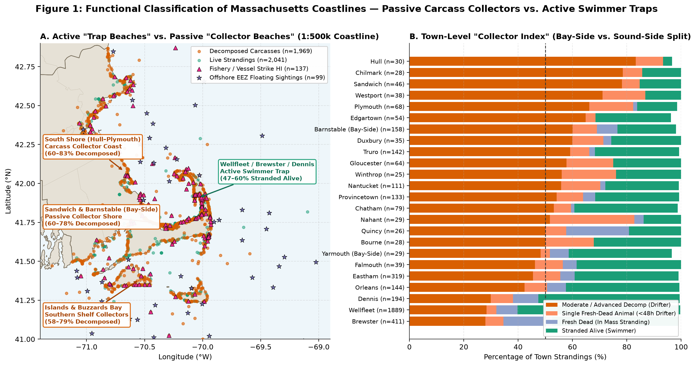

**Figure 1** maps this functional divide across the state. In **Figure 1A (left, plotted on the U.S. Census `1:500,000` geographic coastline)**, green circles (`n = 2,041`) mark animals that stranded **Alive**, orange circles (`n = 1,969`) mark **Decomposed Carcasses**, pink triangles (`n = 137`) mark coastal **Confirmed Fishery Entanglements or Vessel Strikes**, and purple stars (`n = 99`) mark floating carcasses spotted at sea in the **Offshore `EEZ`**. Green circles cluster overwhelmingly inside the inner hook of **Wellfleet, Brewster, and Dennis**, where a `3.21 m` (`10.5 ft`, reaching `12–14 ft` on full/new moons) vertical tidal range drains miles of shallow mudflats every six hours [1, 18]. In contrast, orange decomposed-carcass dots line coastlines exposed to long open-water wind and current fetch: the **South Shore (`Hull–Plymouth`)**, **Bay-Side Sandwich and Barnstable**, the **North Shore (`Gloucester / Cape Ann`)**, and the **Southern Islands and Buzzards Bay (`Martha's Vineyard`, `Nantucket`, `Westport`)**.

**Figure 1B (right)** ranks each town by its 100% condition breakdown (`with a vertical dashed reference line at 50%`). At the top sit the purest **Passive Carcass Collectors**—led by **Hull (`83.3%` decomposed, `93.3%` total drifters)**, **Chilmark (`78.6%` decomposed)**, **Sandwich (`78.3%` decomposed, `84.8%` total drifters)**, **Westport (`71.1%` decomposed)**, **Plymouth (`66.7%` decomposed)**, **Edgartown (`63.6%` decomposed)**, and **Bay-Side Barnstable (`60.1%` decomposed)**—while at the bottom sit the purest **Active Swimmer Traps** (**Wellfleet `59.8%` alive / `28.4%` decomposed**, **Dennis `52.1%` alive**, and **Brewster `46.5%` alive / `28.0%` decomposed**).

| Town / Coastline Segment | Massachusetts Coastal Region | Total Strandings (`n`) | Stranded Alive (`%`) | Decomposed (`Mod + Adv + Mum`, `%`) | Total Drifters (`Decomp + Single Fresh`, `%`) | Functional Beach Classification |
| :--- | :--- | :---: | :---: | :---: | :---: | :--- |
| **Hull** | South Shore / Boston Harbor Approach | 30 | **3.3%** | **83.3%** | **93.3%** | **Passive Carcass Collector** |
| **Chilmark (MV)** | Martha's Vineyard (Dukes County) | 28 | **14.3%** | **78.6%** | **85.7%** | **Passive Carcass Collector** |
| **Sandwich** | Bay-Side Upper Cape (Cape Cod Bay) | 46 | **15.2%** | **78.3%** | **84.8%** | **Passive Carcass Collector** |
| **Westport** | Buzzards Bay / Southern Shelf | 38 | **13.2%** | **71.1%** | **86.8%** | **Passive Carcass Collector** |
| **Plymouth** | South Shore (Western Mass/Cape Cod Bay) | 69 | **14.5%** | **66.7%** | **82.6%** | **Passive Carcass Collector** |
| **Edgartown (MV)** | Martha's Vineyard (Dukes County) | 55 | **27.3%** | **63.6%** | **69.1%** | **Passive Carcass Collector** |
| **Barnstable (Bay-Side)** | Bay-Side Mid Cape (Sandy Neck / Barnstable Hbr) | 158 | **23.4%** | **60.1%** | **69.0%** | **Passive Carcass Collector** |
| **Duxbury** | South Shore (Duxbury / Plymouth Bay) | 35 | **25.7%** | **60.0%** | **71.4%** | **Passive Carcass Collector** |
| **Truro** | Outer / Lower Cape | 142 | **31.0%** | **59.2%** | **66.2%** | **Passive Carcass Collector** |
| **Gloucester** | North Shore / Cape Ann (Essex County) | 65 | **24.6%** | **58.5%** | **75.4%** | **Passive Carcass Collector** |
| **Nantucket** | Nantucket Island | 116 | **25.9%** | **57.8%** | **71.6%** | **Passive Carcass Collector** |
| **Provincetown** | Cape Tip / Race Point | 137 | 29.9% | 54.7% | 64.2% | Mixed Trap / Collector |
| **Chatham** | Outer Cape / Monomoy | 81 | 37.0% | 54.3% | 60.5% | Mixed Trap / Collector |
| **Eastham** | Inner Hook / Nauset | 319 | 38.2% | 45.5% | 55.5% | Mixed Trap / Collector |
| **Orleans** | Inner Hook / Nauset | 145 | 41.4% | 42.8% | 51.0% | Mixed Trap / Collector |
| **Brewster** | Inner Cape Cod Bay Hook (Tidal Flats) | 411 | **46.5%** | **28.0%** | **34.5%** | **Active Swimmer Trap** |
| **Dennis** | Inner Cape Cod Bay Hook (Tidal Flats) | 194 | **52.1%** | **29.9%** | **38.1%** | **Active Swimmer Trap** |
| **Wellfleet** | Inner Cape Cod Bay Hook (Tidal Flats) | 1,889 | **59.8%** | **28.4%** | **32.0%** | **Active Swimmer Trap** |

---

### 2.2 Species Guild Divergence and the Spring Harbor Porpoise Spike

From the `4,831` total records, we isolated **`2,282` back-trackable coastal drifters** (`Moderate Decomposition`, `Advanced Decomposition`, single fresh-dead animals discovered `<48h` post-mortem, and confirmed `Fishery / Entanglement` or `Vessel Strike` mortalities) plus **`99` offshore `EEZ` floating sightings** ([`cohort_summary_table.csv`](data/cohort_summary_table.csv)).

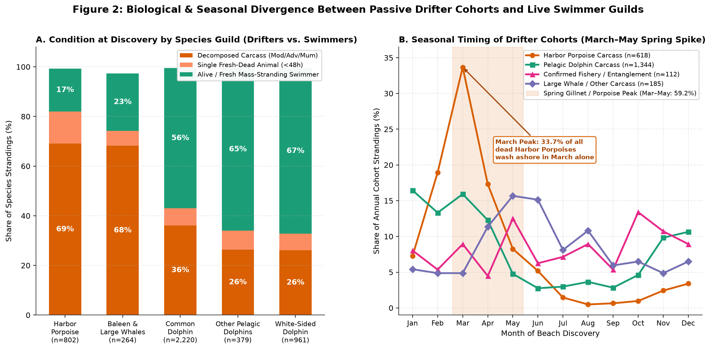

**Figure 2A (left)** shows why taxonomy and decomposition condition are tightly linked: **Harbor Porpoises (`n = 802`)** and **Baleen & Large Whales (`n = 264`)** arrive on Massachusetts beaches almost entirely dead (**`69%` and `68%` decomposed**, plus `13%` and `6%` single fresh-dead animals—only `17%–23%` alive), whereas social **Pelagic Dolphins** (`Common Dolphin`, `Other Pelagic Dolphins`, `White-Sided Dolphin`) arrive **`56%` to `67%` Alive or Fresh-in-MSE**. Plotting the monthly seasonal cycle of each drifter cohort in **Figure 2B (right)** isolates a striking biological signal (`shaded orange band, Mar–May`): **`33.7%` of all dead Harbor Porpoises wash ashore in March alone, and `59.2%` wash ashore across March–May**, coinciding directly with spring sink-gillnet fishing effort in the southwestern Gulf of Maine [7].

| Stage 2 Analytical Cohort | Records (`n`) | Fresh Dead (`<48h`) | Moderate Decomp | Advanced Decomp | Alive (HI Only) | Winter (`DJF %`) | Spring (`MAM %`) | Summer (`JJA %`) | Autumn (`SON %`) |
| :--- | :---: | :---: | :---: | :---: | :---: | :---: | :---: | :---: | :---: |
| **`1. Confirmed Fishery / Entanglement`** | **112** | 14 | 51 | 10 | 30 | 22.3% | 25.9% | 22.3% | **29.5%** |
| **`2. Confirmed Vessel Strike`** | **23** | 1 | 12 | 4 | 6 | 8.7% | 26.1% | **39.1%** | 26.1% |
| **`3. Harbor Porpoise Carcass`** | **618** | 98 | 414 | 106 | 0 | 29.6% | **59.2%** | 7.1% | 4.0% |
| **`4. Pelagic Dolphin Carcass`** | **1,344** | 244 | 859 | 241 | 0 | **40.4%** | 33.0% | 9.4% | 17.3% |
| **`5. Large Whale / Other Carcass`** | **185** | 17 | 82 | 86 | 0 | 16.8% | 31.9% | **34.1%** | 17.3% |
| **`6. Offshore EEZ Sighting (Validation)`** | **99** | 10 | 60 | 19 | 5 | 17.2% | 30.3% | **36.4%** | 16.2% |

---

## 3. Physics & Methodology: The Monte Carlo Lagrangian Reverse-Drift Engine (`Engine v2`)

### 3.1 Backward Advection-Diffusion Equation, Wind Leeway, and Temperature-Scaled Bloat

To reconstruct the at-sea origin of each beached carcass, [`engine_v2/reverse_drift_v2.py`](engine_v2/reverse_drift_v2.py) couples 26 years (`1999-12-01` to `2025-12-31`, `9,528` daily fields) of `0.083°` (`~8 km`) Copernicus `GLORYS12V1` surface ocean eastward velocity (`uo`), northward velocity (`vo`), and sea surface temperature (`thetao`) across **`40.2°N–43.2°N, 71.6°W–68.5°W`** ([`glorys_wide_surface_1999_2025.nc`](data/glorys_wide_surface_1999_2025.nc) [32]) with regional `ERA5` 10-meter wind vectors (`u10`, `v10` [33]).

Because the exact post-mortem drift duration and wind exposure of an individual carcass are uncertain within biological bounds, tracing a single deterministic line would be misleading. Instead, we use the **Monte Carlo method** [31]—running the simulation 50 times per carcass with randomly sampled physical parameters drawn from empirically validated ranges. For each carcass $i \in \{1, \dots, 2282\}$ discovered on date $t_0$ at shoreline water coordinate $\mathbf{x}_i(t_0) = (\text{lon}_i, \text{lat}_i)$, we launch **$M = 50$ virtual particles (`114,100` total trajectories)** and integrate **backward in time** at **30-minute time steps ($\Delta t = 0.5\text{ hours} = 1,800\text{ s}$)** [22]:

$$\mathbf{x}_{i,m}(t - \Delta t) = \mathbf{x}_{i,m}(t) - \left[\mathbf{u}_{\text{ocean}}\!\left(\mathbf{x}_{i,m}(t), t\right) + \alpha_{i,m}\,\mathbf{R}(\theta_{i,m})\,\mathbf{W}_{10\text{m}}\!\left(\mathbf{x}_{i,m}(t), t\right)\right]\Delta t + \sqrt{2 K_h \Delta t}\,\boldsymbol{\xi}_{i,m}(t)$$

Each component of this equation captures a specific physical or biological mechanism:

* **Submerged Current Advection ($\mathbf{u}_{\text{ocean}}$) and Aerodynamic Wind Leeway ($\alpha_{i,m}\mathbf{R}(\theta_{i,m})\mathbf{W}_{10\text{m}}$) [4, 23–27]:** Why does wind push a floating cetacean carcass at `1.5% to 3.5%` of the 10-meter wind speed? Because biological tissue and blubber have a density (`~0.95–1.02 g/cm³`) only slightly lower than seawater (`~1.025 g/cm³`), Archimedes' principle dictates that even a gas-bloated carcass floats with **`80%` to `90%` of its volume submerged underwater** and only **`10%` to `20%` of its rounded dorsal surface exposed to the air**—a buoyancy ratio measured directly for cetacean drift modeling in Météo-France's `MOTHY` system by Peltier et al. [4, 25, 26] and formulated for partially submerged drifting bodies by Daniel et al. [23] and Breivik et al. [24]. The submerged `85%–90%` is locked into the surface ocean current $\mathbf{u}_{\text{ocean}}(\mathbf{x}, t)$ (`moving at 100% of the water velocity`), while the emergent `10%–15%` acts as a low-profile sail subject to direct aerodynamic wind drag plus wave-induced *Stokes drift*. Balancing air drag against water drag yields a net **wind leeway coefficient $\alpha_{i,m} \sim \text{Uniform}(0.015, 0.035)$** (`1.5%–3.5%` of the 10-meter wind speed $\mathbf{W}_{10\text{m}}$), rotated by a stochastic crosswind divergence angle **$\theta_{i,m} \sim \mathcal{N}(0^\circ, 8^\circ)$** because an elongated carcass drifts slightly left or right of dead downwind [24].
* **Sub-Grid Turbulent Eddy Dispersion ($\sqrt{2 K_h \Delta t}\,\boldsymbol{\xi}_{i,m}$) [30]:** While `GLORYS12V1` resolves mesoscale coastal currents at `~8 km` spacing, real shelf waters also contain smaller eddies, tidal rips, and shear zones narrower than 8 km. Following Okubo's classic oceanic diffusion scaling diagram for `~8 km` grid scales [30], we add an isotropic Gaussian random walk with horizontal eddy diffusivity **$K_h = 20\text{ m}^2/\text{s}$** ($\boldsymbol{\xi}_{i,m} \sim \mathcal{N}(\mathbf{0}, \mathbf{I}_2)$, equivalent to `~0.25 km` of turbulent dispersion every 30 minutes).
* **Temperature-Conditioned Decomposition Drift Windows ($T_{\text{drift}}^{(i,m)}$) [5, 6, 28, 29]:** How far back in time we rewind each particle is governed by the carcass's Smithsonian/NOAA Condition Code at discovery [6]: at a reference sea surface temperature of $T_0 = 10^\circ\text{C}$, base drift duration $T_{\text{base}}^{(i,m)}$ is drawn uniformly from **`0.5–2.0 days` for single Fresh Dead animals (Code 2)**, **`3.0–8.0 days` for Moderate Decomposition (Code 3)**, and **`8.0–16.0 days` for Advanced Decomposition (Code 4)** [4, 25, 27]. However, internal bacterial putrefaction is a biochemical reaction governed by the **Boltzmann–Arrhenius temperature law** [28], which forms the basis of forensic accumulated degree-day (`ADD`) post-mortem interval estimation [29] and was documented specifically for Northwest Atlantic cetacean carcasses by Moore et al. [5]. Because microbial gas generation roughly doubles for every $10^\circ\text{C}$ rise in water temperature ($Q_{10} = \exp(10\gamma) \approx 1.73$ with $\gamma = 0.055\,^\circ\text{C}^{-1}$), a carcass in warm `18°C` summer water bloats rapidly and reaches Code 3 in **~3.5 days**, whereas in near-freezing `4°C` winter/spring water inside Cape Cod Bay, slowed bacterial metabolism allows a carcass to drift for **~7.7 days** in Code 3 before reaching Code 4:
  $$T_{\text{drift}}^{(i,m)} = \text{clip}\!\left(T_{\text{base}}^{(i,m)} \cdot \exp\!\left[-0.055 \cdot (T_{\text{water}, i} - 10^\circ\text{C})\right],\, 0.375\text{ d},\, 21.0\text{ d}\right)$$

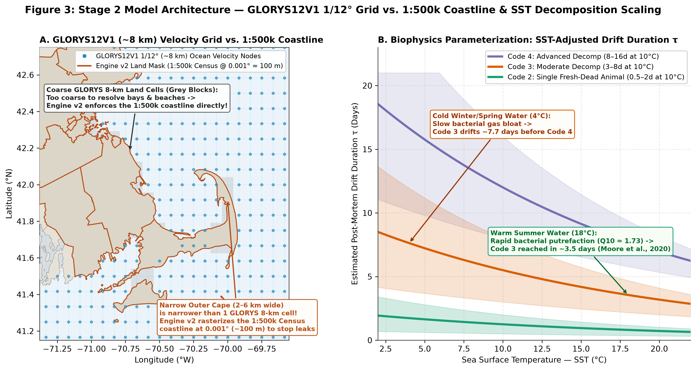

**Figure 3** illustrates our spatial and biophysical model architecture. **Figure 3A (left)** overlays the `GLORYS12V1` `1/12°` (`~8 km`) ocean velocity nodes (blue dots) and coarse `8-km` land cells (grey squares) onto the **U.S. Census Bureau `1:500,000` geographic coastline** (brown outline). Notice why the coarse `GLORYS` land mask cannot be used as the coastline boundary: the entire Lower and Outer Cape (`Orleans` through `Wellfleet` and `Truro` to `Provincetown`) is only **2 to 6 km wide**—narrower than a single `8-km` `GLORYS` grid cell! **Figure 3B (right)** plots the Arrhenius `SST`-adjusted drift duration curves ($T_{\text{drift}}$ vs. $\text{SST}$) for Codes 2, 3, and 4, showing the expansion of drift duration in cold winter/spring water (`4°C`) versus warm summer water (`18°C`).

---

### 3.2 Engineering Audit (`Engine v1` $\rightarrow$ `Engine v2`), Shore-Contact Boundary Rules (`Hold` vs. `Strand`), and Hydrodynamic Limitations

In our preliminary prototype (`Engine v1`), we used the coarse `8-km` `GLORYS` land mask supplemented by a hand-drawn 19-vertex polygon around Cape Cod, integrated at `3-hour` time steps ($\Delta t = 3\text{ h}$) checking only step endpoints, and summarized each animal's 50 particle endpoints using their simple coordinate average (`arithmetic mean`). When we overlaid `Engine v1` onto the true `1:500,000` Massachusetts coastline, we found that `35.1%` of `v1` trajectories jumped across narrow peninsulas (because a 3-hour step spans `2–4 km` and the 19-vertex polygon had a self-intersecting fold near Provincetown), and `347` of the `2,282` animals had their average origin point sitting on dry land!

To achieve full geometric and physical rigor, we rebuilt the simulation from scratch as **`Engine v2`** ([`engine_v2/reverse_drift_v2.py`](engine_v2/reverse_drift_v2.py)) with four structural upgrades:
1. **`0.001°` (`~100 m`) Rasterized `1:500,000` Census Coastline:** We discarded the 19-vertex polygon and rasterized the actual **U.S. Census Bureau `1:500,000` coastline (`cb_2023_us_county_500k.zip`) at `0.001°` (`~100 m`) resolution** with a `50 m` landward safety buffer ([`land_mask_0p001deg_buf50m.npz`](data/v2/land_mask_0p001deg_buf50m.npz)). Every map in Stage 2 (`Figures 1, 3A, 4, 5A, 6A, 8, 9, and 10`) now renders on the exact same `1:500,000` geographic coastline enforced by the physics engine.
2. **Full-Segment Collision Checking at $\Delta t = 30\text{ min}$ (`0.0%` Land Crossing):** At every 30-minute step, `Engine v2` sub-samples the straight-line segment between $\mathbf{x}(t)$ and $\mathbf{x}(t-\Delta t)$ at intervals of $\le 0.5$ raster cells (`~50 m`), stopping at the exact last water sub-step before any land cell is touched. Across all `114,100` simulated trajectories, **zero segments ever cross dry land**.
3. **Choosing the Most Central Water Particle Instead of a Simple Coordinate Average:** Why did `347` summary origin dots fall on dry land in `v1`? Because Cape Cod is shaped like a curved hook (`C`), if 25 of an animal's simulated water particles end up north of a peninsula and 25 end up south of it, taking their regular mathematical average draws a straight line between them and drops the "average coordinate" onto dry ground in the middle of the peninsula. Instead of inventing an artificial average coordinate, `Engine v2` selects **whichever one of the 50 actual simulated water particles sits closest to the other 49 water particles** (`known in statistics as the medoid`). Because it selects an actual water particle from the ensemble, the summary origin is guaranteed to lie in the water (`reducing land-falling centers from 347 in v1 to 0–3 out of 2,282 [<0.15%]`).
4. **Testing Both Physical Shore-Contact Boundary Assumptions (`Rule B: Hold` vs. `Rule A: Strand`):** When rewinding a trajectory backward in time from a beach discovery site, what happens if wind and currents push a virtual particle against a shoreline two days before its final discovery date? In the oceanographic particle-tracking literature [4, 22, 25–27], two boundary assumptions are used, and rather than assuming one is universally true, `Engine v2` runs and reports **both** across every table and figure:
   - **Rule B (`v2 Hold` — Shoreline Hold / Refloating Permitted, `OpenDrift` `'previous'` convention [22]):** When a particle touches the `1:500k` coastline, it pauses at its last water sub-step (`0 m` into land) and waits in the surf zone until shifting winds or currents push it back offshore. Physically, this represents carcasses that wash into shallow water, refloat on a subsequent tide or wind shift, and continue drifting (`resolving 100.0% [2,282 / 2,282] of animals`).
   - **Rule A (`v2 Strict Strand` — Strict One-Way Stranding, `OpenDrift` `'stranding'` convention [22, 26]):** In reality, many carcasses that hit a sandy beach become high-centered and stay beached—meaning a backward trajectory that intersects a coastline mid-drift would have stranded earlier at that other beach instead of reaching the discovery site. Under `v2 Strict Strand`, once a particle moves beyond a near-shore departure grace radius (`grace_km = 2.0 km` baseline, `5.0 km` sensitivity, or after `12 hours`), any subsequent shoreline contact permanently terminates that trajectory as `STRANDED` (`status = 1`) and excludes it from origin statistics. Under `Strict Strand (2 km)`, **`1,045 / 2,282` animals (`45.8%`, `16.6%` of all particles)** achieve $\ge 1$ completely land-free open-water trajectory (`rising to 1,444 / 2,282 [63.3%] at 5 km grace`).

**Explicit Hydrodynamic Limitations of `GLORYS12V1`:** Even with the exact `1:500,000` coastline enforced in `Engine v2`, three physical limitations of the underlying ocean reanalysis must be recognized when interpreting near-shore trajectories. First, `CMEMS GLORYS12V1` [32] provides **daily-mean** currents and does not resolve the `12.42-hour` semidiurnal astronomical tide (`M2` [18]) or surf-zone wave radiation stress; inside Cape Cod Bay (`where tidal range is 3.2 m`) and across Nantucket Shoals (`where tidal currents exceed 1.5–2.5 m/s`), `6-hour` tidal excursions and tidal refloating are only approximated stochastically by sub-grid diffusion ($K_h = 20\text{ m}^2/\text{s}$) and the bracket between `Hold` and `Strand`. Second, because `GLORYS` velocity nodes are spaced every `~8 km` (`Figure 3A`), velocities within `0–4 km` of shore are extrapolated from the nearest offshore wet cells without resolving `100–500 m` littoral longshore drift cells or harbor inlet jets. Third, because the narrow Outer Cape (`2–6 km` wide) has no land cells inside `GLORYS12V1`'s underlying `8-km` solver, `Engine v2`'s `100 m` land mask physically blocks particles from crossing the peninsula, but the background `GLORYS` current vectors immediately adjacent to the Outer Cape do not include fine-scale hydrodynamic deflection around the peninsula tip.

---

## 4. Results, Case-Study Verification & Source–Receptor Attribution

### 4.1 Inferred Mortality Sites: Four Verifiable NOAA Case Studies (`Figure 4`) and Weather Proof (`Figure 5`)

Before aggregating all `2,282` drifters, **Figure 4** maps the 50-particle reverse plumes on the **`1:500,000` U.S. Census coastline** for **four real, verifiable cetacean carcasses** from [`backtracked_drifters_v2_hold.parquet`](data/v2/backtracked_drifters_v2_hold.parquet):

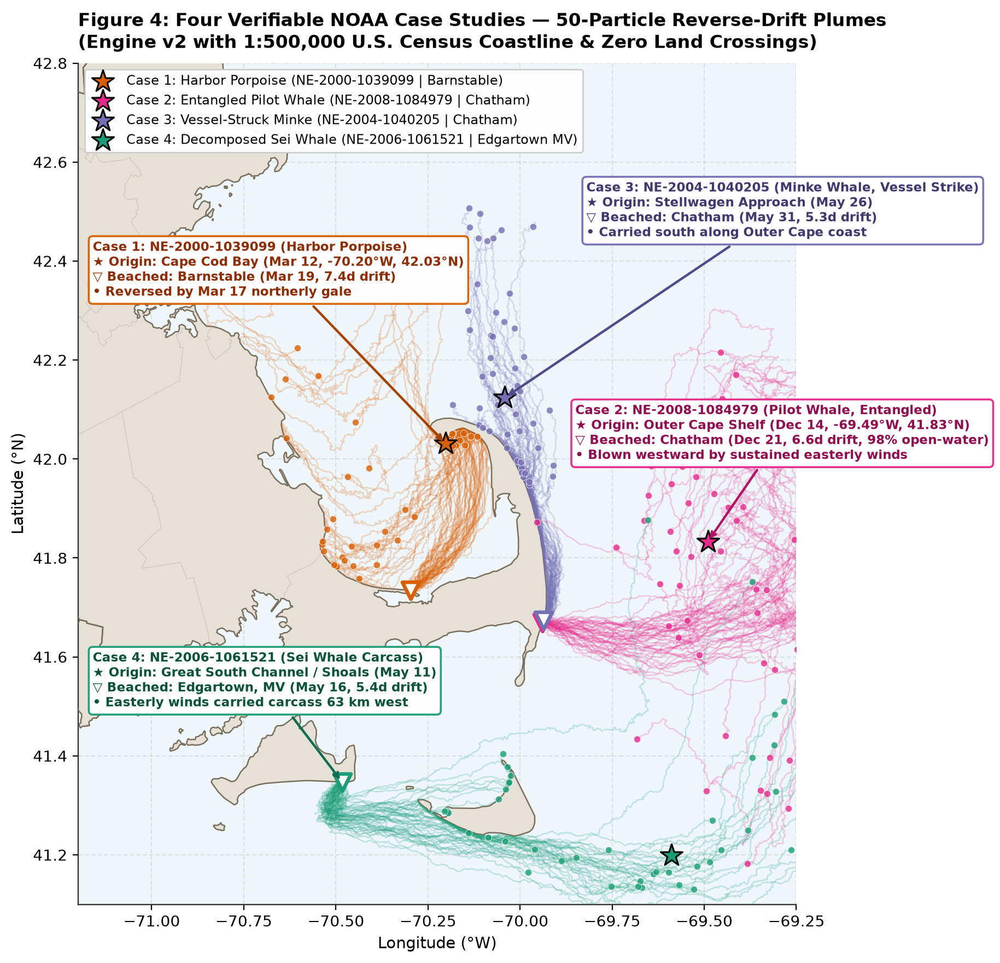

In **Figure 4**, each upside-down triangle (`▽` on the shoreline) marks the exact beach coordinate where stranding responders found the carcass; the 50 thin curves of the same color trace the individual 30-minute Monte Carlo reverse trajectories (`with 0% land crossings across Cape Cod, Monomoy, Martha's Vineyard, or Nantucket`); the small colored dots (`•`) mark the 50 individual water endpoints where each particle's temperature-scaled drift clock expired; and the star (`★`) marks the animal's central water origin:

| Plume Color | NOAA Database ID | Discovery Date | Species & Condition | Beach Discovery Site (`▽`) | `v2 Hold` Central Origin (`★`) | `v2 Strict Strand (2km)` Open-Water Survival & Origin | Physical Weather & Current Mechanism |
| :--- | :--- | :---: | :--- | :--- | :--- | :--- | :--- |
| **Orange** | `NE-2000-1039099` | `2000-03-19` | Harbor Porpoise (`Moderate Decomp`, Code 3) | Barnstable Bay-Side (`41.73°N, -70.30°W`) | Eastern/Central Cape Cod Bay (`42.03°N, -70.20°W`, `7.4d`) | `36%` (`18/50`) open-water (`41.83°N, -70.44°W`, `Cape Cod Bay`) | Southerly wind (`+6.5 m/s` on Mar 14–16) pushed carcass toward P-town/Truro; northerly gale (`-12.1 m/s` on Mar 17–19) drove it south onto Barnstable (`Figure 5`). |
| **Pink** | `NE-2008-1084979` | `2008-12-21` | Pilot Whale (`Fishery Entanglement`, Code 3) | Chatham Outer Beach (`41.67°N, -69.93°W`) | Outer Cape / Nauset Shelf (`41.83°N, -69.49°W`, `6.6d`) | **`98%` (`49/50`) open-water** (`41.83°N, -69.49°W`, `Outer Cape Shelf`) | Sustained December easterly winds and shelf currents pushed the entangled carcass 41 km straight west from the open Atlantic onto Chatham without touching shore en route. |
| **Purple** | `NE-2004-1040205` | `2004-05-31` | Minke Whale (`Vessel Strike`, Code 3) | Chatham (`41.68°N, -69.93°W`) | Stellwagen Bank Approach (`42.13°N, -70.04°W`, `5.3d`) | `14%` (`7/50`) open-water (`42.19°N, -70.05°W`, `Stellwagen Approach`) | The southward coastal current along the Outer Cape carried the vessel-struck whale south from the Stellwagen approach past Nauset to Chatham. |
| **Green** | `NE-2006-1061521` | `2006-05-16` | Sei Whale (`Moderate Decomp`, Code 3) | Edgartown, Martha's Vineyard (`41.35°N, -70.48°W`) | Great South Channel / Shoals (`41.20°N, -69.58°W`, `5.4d`) | `64%` (`32/50`) open-water (`41.18°N, -69.67°W`, `Southern Shelf / Shoals`) | Spring easterly winds (`-6 to -9 m/s` westward) pushed the floating whale ~63 km west across the Nantucket Sound/Shoals corridor onto Edgartown. |

To see how **Rule A (`Strict Stranding` — terminating any particle that touches shore after leaving the 2 km departure zone)** compares visually against **Rule B (`Shoreline Hold / Refloating` — holding particles at the water's edge until offshore winds/currents refloat them)** on these same four animals, compare the two side-by-side panels below:

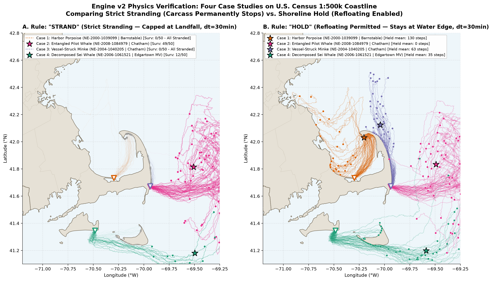

#### Step-by-Step Weather Verification of Case 1 (`NE-2000-1039099`, `Figure 5`)

How can we verify that these curved trajectories reflect real historical weather events rather than arbitrary lines? In **Figure 5**, we zoom into Cape Cod Bay on the `1:500,000` coastline for **Case 1 (`NE-2000-1039099`, Figure 5A)** and plot the raw daily 10-meter wind velocities recorded in `environmental_daily.parquet` from **March 11 to March 19, 2000 (`Figure 5B`)**:

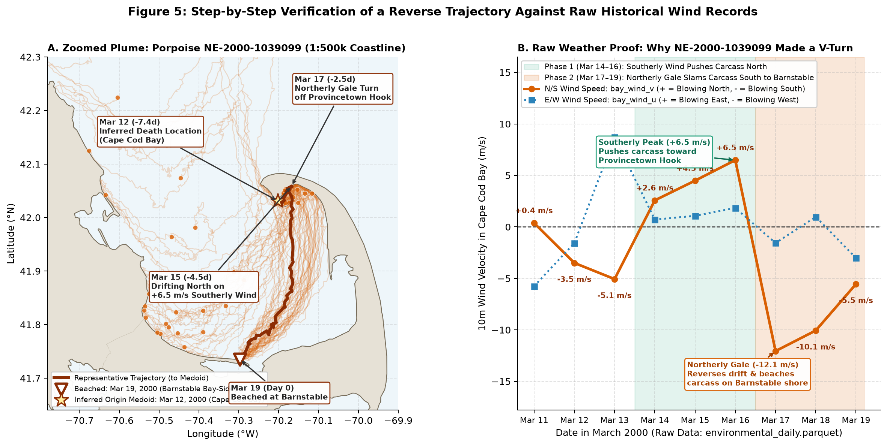

Reading the trajectory in **Figure 5A** in forward chronological order (`from the Mar 12 ★ origin to the Mar 19 ▽ beaching`) alongside the raw wind time series in **Figure 5B** shows exact physical agreement. On **March 12 (`-7.4d`, `★`)**, the harbor porpoise dies in Cape Cod Bay in cold `4.5°C` water (`orange ★ = v2 Hold origin at 42.03°N, -70.20°W`; `blue ★ = v2 Strict Strand origin at 41.83°N, -70.44°W`). During **Phase 1 (`March 14–16`, green shaded box in Figure 5B)**, the north–south wind component `bay_wind_v` (`where positive values blow toward the North`) climbs from **`+2.6 m/s` (`Mar 14`) to `+4.5 m/s` (`Mar 15`) and peaks at `+6.5 m/s` (`~15 mph` southerly wind on `Mar 16`)**, pushing the floating carcass northeastward toward the Truro/Provincetown Hook (`where Hold particles wait at the inner shoreline while the 36% Strict Strand particles stay in open water in central Cape Cod Bay`). Then, during **Phase 2 (`March 17–19`, orange shaded box in Figure 5B)**, a cold front passes and `bay_wind_v` violently reverses from `+6.5 m/s` to **`-12.1 m/s` (`~27 mph` northerly gale blowing South on `Mar 17`)**, remaining strongly southward at **`-10.1 m/s` (`Mar 18`)** and **`-5.5 m/s` (`Mar 19`)**—producing the sharp V-turn Apex on March 17 and driving the carcass straight into Barnstable's north-facing shore on **March 19 (`Day 0, ▽`)**.

---

### 4.2 Offshore Ground-Truth Validation: Testing Beach Backtracks Against 77 Independent `EEZ` Sightings (`Figure 6`)

Because **zero offshore `EEZ` records were ever used to fit or run the backtracking simulation**, the **`77` in-domain `EEZ` floating carcass sightings** (dead whales, entangled animals, and floating carcasses spotted at sea by Coast Guard vessels, NOAA aerial surveys, and mariners) provide an independent offshore ground-truth benchmark to test whether our backtracked beach-carcass spatial density map peaks in the same waters where floating carcasses are actually observed at sea.

To convert `114,100` particle endpoints into a continuous spatial probability surface, we use two-dimensional **Kernel Density Estimation (`KDE`)** [34, 35], which places a smooth 2D Gaussian bell curve over every backtracked water endpoint and sums their heights across the ocean domain (`masked cleanly to the 1:500,000 coastline`).

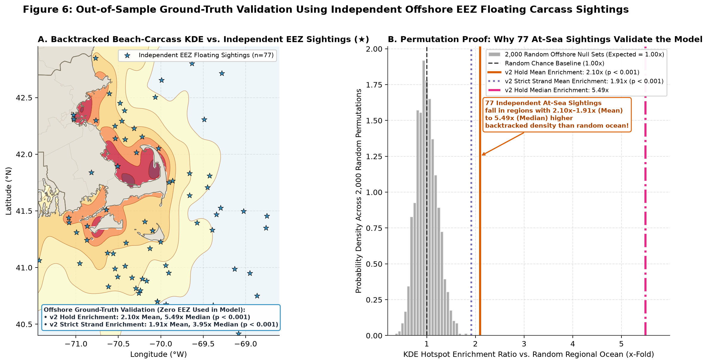

In **Figure 6A (left)**, the yellow-orange-red shaded contours map the backtracked `KDE` density of coastal large-whale and human-interaction beach carcasses (`n = 320 × 50 = 16,000` particle endpoints), while the **`77` blue stars (`★`)** mark the exact coordinates of independent `EEZ` floating carcass sightings. Visually, the blue stars cluster inside the high-density contour plumes on **Stellwagen Bank, Massachusetts Bay, Outer Cape Cod, and the Southern Shelf**. **Figure 6B (right)** tests whether this spatial overlap could occur by chance across **`2,000` random spatial permutations**: when 77 random ocean coordinates are drawn 2,000 times (`grey histogram`), their expected `KDE` enrichment ratio is **`1.00x`** (`ranging from 0.6x to 1.5x`). The actual `KDE` density at the 77 real `EEZ` sighting coordinates achieves a **`2.10x` Mean Enrichment and `5.49x` Median Enrichment under `v2 Hold`** (`solid orange and dash-dotted pink lines`) and a **`1.91x` Mean Enrichment and `3.95x` Median Enrichment under `v2 Strict Strand`** (`dotted purple line`)—exceeding all 2,000 random permutations (**$p < 0.0005$ under both shore-contact rules**).

---

### 4.3 The Source–Receptor Matrix and Shore-Rule / Forcing Sensitivity (`Figure 7`)

Classifying each animal's central water origin (`★`) into 6 regional marine basins under both **`v2 Hold`** ([`source_receptor_matrix_v2_hold.csv`](data/v2/source_receptor_matrix_v2_hold.csv)) and **`v2 Strict Strand (2 km)`** ([`source_receptor_matrix_v2_strand2km.csv`](data/v2/source_receptor_matrix_v2_strand2km.csv)) quantifies which offshore waters supply carcasses to each stretch of the Massachusetts coast.

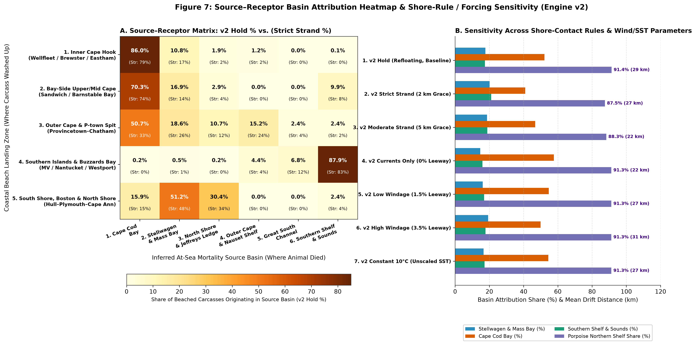

In **Figure 7A (left)**, each row represents a **Coastal Beach Landing Zone (Receptor)** where carcasses washed ashore (`summing to 100% across the 6 columns`), and each column represents the **Inferred At-Sea Mortality Source Basin** where the animals died, displaying both **`v2 Hold %`** and **`(Strict Strand %)`** inside every cell:

1. **Inner Cape Hook (`Wellfleet / Brewster / Eastham`, Row 1) and Bay-Side Upper/Mid Cape (`Sandwich / Barnstable Bay`, Row 2):** In our superseded `v1` prototype, coarse-grid tunneling across the narrow Outer Cape arm had artificially inflated cross-boundary transport from Stellwagen Bank into Cape Cod Bay to `51.0%–54.6%`. With the real `1:500,000` coastline enforced at `100 m` resolution in `Engine v2`, **`86.0% [79.2%]` of decomposed carcasses washing onto the Inner Cape Hook** and **`70.3% [73.5%]` washing onto Bay-Side Upper/Mid Cape** originated **inside `1. Cape Cod Bay`**, while a genuine **`12.7% [19.0%]` (Inner Hook)** and **`19.8% [18.4%]` (Bay-Side Upper/Mid Cape)** blew southward into the Bay from **Stellwagen Bank, Massachusetts Bay, and Jeffreys Ledge (North Shore)**.
2. **Outer Cape & Provincetown Spit (`Provincetown–Chatham`, Row 3):** Acts as a true multi-basin coastal collector, drawing **`50.7% [32.9%]` from `Cape Cod Bay`**, **`18.6% [25.8%]` from `Stellwagen Bank & Mass Bay`**, **`10.7% [11.6%]` from `North Shore & Jeffreys Ledge`**, and **`15.2% [23.9%]` from the `Outer Cape & Nauset Shelf`**.
3. **Southern Islands & Buzzards Bay (`Martha's Vineyard / Nantucket / Westport`, Row 4):** **`94.7%` (`87.9%` Southern Shelf + `6.8%` Great South Channel under `Hold`) / `94.4%` (`82.7%` + `11.7%` under `Strict Strand`)** originated on the southern shelf and channel, with **`< 1.0%` crossover** from Cape Cod Bay or Stellwagen Bank.
4. **South Shore, Boston & North Shore (`Hull–Plymouth–Cape Ann`, Row 5):** **`81.6%` (`51.2%` Stellwagen/Mass Bay + `30.4%` North Shore under `Hold`) / `81.9%` (`47.7%` + `34.2%` under `Strict Strand`)** originated in Stellwagen Bank, Massachusetts Bay, and Jeffreys Ledge (`with 15.9% [14.6%] from Cape Cod Bay`).

**Figure 7B (right)** evaluates sensitivity across 7 `Engine v2` shore-contact and forcing configurations ([`sensitivity_analysis_table_v2.csv`](data/v2/sensitivity_analysis_table_v2.csv)). Across all 7 configurations—spanning `Hold`, `Strict Strand (2 km)`, `Moderate Strand (5 km)`, `Currents Only (0% Leeway)`, `Low Windage (1.5%)`, `High Windage (3.5%)`, and `Unscaled Constant 10°C SST`—the **Harbor Porpoise Northern Shelf Share (purple bar)** remains invariant between **`87.5%` and `91.4%`**, while removing wind leeway (`0% Leeway`) reduces mean drift distance from `29.1 km` to `21.7 km`.

| Coastal Beach Landing Zone (Receptor) | `1. Cape Cod Bay` (`Hold [Strand]`) | `2. Stellwagen & Mass Bay` (`Hold [Strand]`) | `3. North Shore & Jeffreys` (`Hold [Strand]`) | `4. Outer Cape Shelf` (`Hold [Strand]`) | `5. Great South Channel` (`Hold [Strand]`) | `6. Southern Shelf & Sounds` (`Hold [Strand]`) | Resolved Animals (`Hold [Strand]`) |
| :--- | :---: | :---: | :---: | :---: | :---: | :---: | :---: |
| **`1. Inner Cape Hook (Wellfleet / Brewster / Eastham)`** | **86.0% [79.2%]** | **10.8% [17.0%]** | 1.9% [2.0%] | 1.2% [1.8%] | 0.0% [0.0%] | 0.1% [0.0%] | `972 [394]` |
| **`2. Bay-Side Upper/Mid Cape (Sandwich / Barnstable Bay)`** | **70.3% [73.5%]** | **16.9% [14.3%]** | 2.9% [4.1%] | 0.0% [0.0%] | 0.0% [0.0%] | 9.9% [8.2%] | `243 [98]` |
| **`3. Outer Cape & P-town Spit (Provincetown–Chatham)`** | **50.7% [32.9%]** | **18.6% [25.8%]** | **10.7% [11.6%]** | **15.2% [23.9%]** | 2.4% [3.9%] | 2.4% [1.9%] | `290 [155]` |
| **`4. Southern Islands, Sound & Buzzards Bay`** | 0.2% [0.0%] | 0.5% [0.5%] | 0.2% [0.0%] | 4.4% [4.2%] | 6.8% [11.7%] | **87.9% [82.7%]** | `412 [214]` |
| **`5. South Shore, Boston & North Shore (Hull–Plymouth–Essex)`** | 15.9% [14.6%] | **51.2% [47.7%]** | **30.4% [34.2%]** | 0.0% [0.0%] | 0.0% [0.0%] | 2.4% [3.5%] | `365 [184]` |

| `Engine v2` Sensitivity Scenario (`Figure 7, Panel B`) | Shore Rule | Resolved Animals (`%`) | Particle Survival (`%`) | Mean Displacement (`km`) | `Cape Cod Bay (%)` | `Stellwagen & Mass Bay (%)` | `Southern Shelf (%)` | `Porpoise Northern Shelf Share (%)` |
| :--- | :---: | :---: | :---: | :---: | :---: | :---: | :---: | :---: |
| **`1. v2 Baseline HOLD (1.5–3.5% Leeway, SST-Scaled)`** | `Hold` | **2,282 (`100.0%`)** | **100.0%** | **29.1 km** | **52.1%** | **17.7%** | **17.4%** | **91.4%** |
| **`2. v2 Strict STRAND (2 km Departure Grace)`** | `Strand 2km` | **1,045 (`45.8%`)** | **16.6%** | **26.6 km** | **41.0%** | **20.2%** | **21.1%** | **87.5%** |
| **`3. v2 Moderate STRAND (5 km Departure Grace)`** | `Strand 5km` | **1,444 (`63.3%`)** | **28.7%** | **21.5 km** | **46.7%** | **18.6%** | **18.8%** | **88.3%** |
| **`4. v2 Ocean Currents Only (0.0% Leeway, Hold)`** | `Hold` | 2,282 (`100.0%`) | 100.0% | 21.7 km | 57.7% | 14.7% | 16.0% | **91.3%** |
| **`5. v2 Low Windage (1.5% Leeway, Hold)`** | `Hold` | 2,282 (`100.0%`) | 100.0% | 27.1 km | 54.7% | 16.1% | 17.0% | **91.3%** |
| **`6. v2 High Windage (3.5% Leeway, Hold)`** | `Hold` | 2,282 (`100.0%`) | 100.0% | 31.1 km | 49.7% | 19.2% | 18.0% | **91.3%** |
| **`7. v2 Unscaled Decay (Constant 10°C SST, Hold)`** | `Hold` | 2,282 (`100.0%`) | 100.0% | 27.3 km | 54.0% | 16.8% | 17.4% | **91.3%** |

---

### 4.4 Hidden At-Sea Mortality Hotspots by Species, Human Interaction, and Season (`Figures 8, 9 & 10`)

To allow every species cohort, human-interaction record, and seasonal regime to be inspected clearly without overcrowding, we present three dedicated side-by-side (`1 × 2`) maps on the **`1:500,000` geographic coastline** ([`cohort_basin_attribution_v2_hold.csv`](data/v2/cohort_basin_attribution_v2_hold.csv) and [`cohort_basin_attribution_v2_strand2km.csv`](data/v2/cohort_basin_attribution_v2_strand2km.csv)):

| Drifter / Mortality Cohort | Mean SST (`°C`) | Mean Drift (`days`) | Mean Drift (`km`, `Hold [Strand]`) | `1. Cape Cod Bay` (`Hold [Strand]`) | `2. Stellwagen & Mass Bay` (`Hold [Strand]`) | `3. North Shore & Jeffreys` (`Hold [Strand]`) | `4. Outer Cape Shelf` (`Hold [Strand]`) | `5. Great South Channel` (`Hold [Strand]`) | `6. Southern Shelf & Sounds` (`Hold [Strand]`) | Resolved (`Hold [Strand]`) |
| :--- | :---: | :---: | :---: | :---: | :---: | :---: | :---: | :---: | :---: | :---: |
| **`1. Confirmed Fishery / Entanglement (`n=112`)`** | 12.1°C | 3.7 d | 24.6 [22.1] km | **38.4% [32.9%]** | **17.0% [20.7%]** | 9.8% [9.8%] | 9.8% [11.0%] | 2.7% [3.7%] | **22.3% [22.0%]** | `112 [82]` (`73.2%`) |
| **`2. Confirmed Vessel Strike (`n=23`)`** | 13.6°C | 4.3 d | 27.1 [29.7] km | 17.4% [7.7%] | **26.1% [30.8%]** | 8.7% [7.7%] | 13.0% [15.4%] | 0.0% [0.0%] | **34.8% [38.5%]** | `23 [13]` (`56.5%`) |
| **`3. Harbor Porpoise Carcass (`n=618`)`** | **6.2°C** | **7.4 d** | **29.5 [27.7] km** | **48.1% [40.9%]** | **30.1% [28.4%]** | **13.3% [18.2%]** | 1.9% [2.7%] | 0.5% [1.5%] | 6.1% [8.3%] | `618 [264]` (`42.7%`) |
| **`4. Pelagic Dolphin Carcass (`n=1,344`)`** | 8.1°C | 6.8 d | 29.1 [24.9] km | **60.3% [47.9%]** | **12.2% [16.8%]** | 5.1% [5.3%] | 3.7% [5.3%] | 1.2% [3.3%] | 17.5% [21.4%] | `1,344 [584]` (`43.5%`) |
| **`5. Large Whale / Other Carcass (`n=185`)`** | 13.0°C | 7.2 d | 30.2 [36.9] km | 19.5% [11.8%] | 15.7% [16.7%] | 9.7% [8.8%] | 2.2% [4.9%] | 5.9% [8.8%] | **47.0% [49.0%]** | `185 [102]` (`55.1%`) |

#### 1. Harbor Porpoises (`n = 618`) vs. Decomposed Pelagic Dolphins (`n = 1,344`) (`Figure 8`)

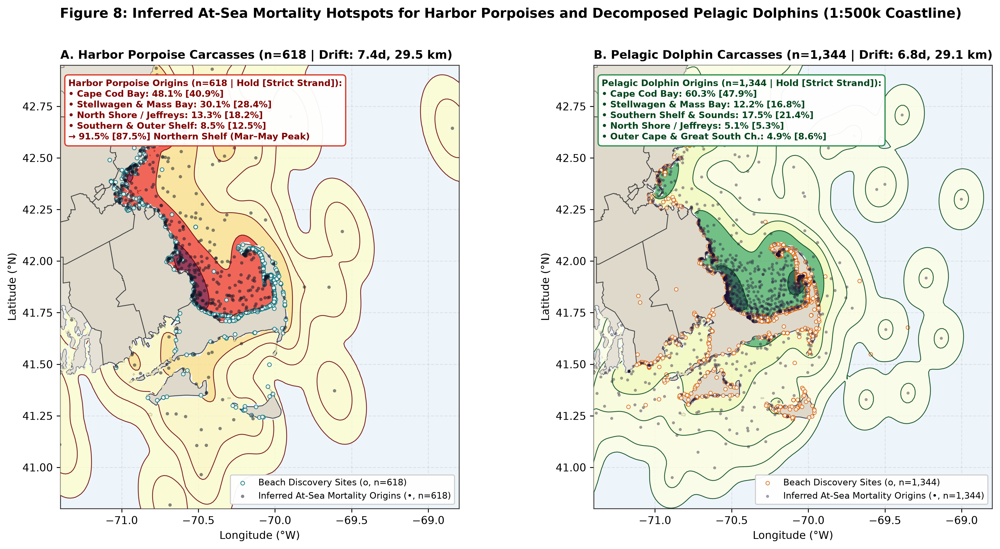

In **Figure 8**, open rings along the coastline (`o`) mark beach discovery sites, semi-transparent dark dots (`•`) mark inferred at-sea mortality origins, and shaded contour rings (`55th` to `99.5th` percentiles, drawn above the dots so interior peaks remain visible) map the 2D `KDE` mortality density. In **Figure 8A (left, Harbor Porpoise Carcasses, `n = 618`)**, **`91.5%` (`v2 Hold`) and `87.5%` (`v2 Strict Strand`)** of dead harbor porpoises backtrack to the northern shelf—concentrated in **Cape Cod Bay (`48.1% [40.9%]`)**, **Stellwagen Bank & Massachusetts Bay (`30.1% [28.4%]`)**, and **North Shore / Jeffreys Ledge (`13.3% [18.2%]`)**, with only `8.5% [12.5%]` on the Southern & Outer Shelf. Because these mortalities occur in cold late-winter and spring water (`mean SST = 6.2°C`), carcasses drift for an average of **`7.4 days` (`29.5 km` net displacement)** from coastal and offshore sink-gillnet fishing grounds [7]. In **Figure 8B (right, Decomposed Pelagic Dolphin Carcasses, `n = 1,344`)**, origins concentrate in **Cape Cod Bay (`60.3% [47.9%]`)**—reflecting animals that died inside the Bay following winter/spring entrapment or cold-water exposure—alongside **Southern Shelf & Sounds (`17.5% [21.4%]`)**, **Stellwagen Bank & Massachusetts Bay (`12.2% [16.8%]`)**, **North Shore / Jeffreys Ledge (`5.1% [5.3%]`)**, and **Outer Cape & Great South Channel (`4.9% [8.6%]`)**.

#### 2. Separating Fishery Entanglements (`n = 112`) from Vessel Strikes (`n = 23`) (`Figure 9`)

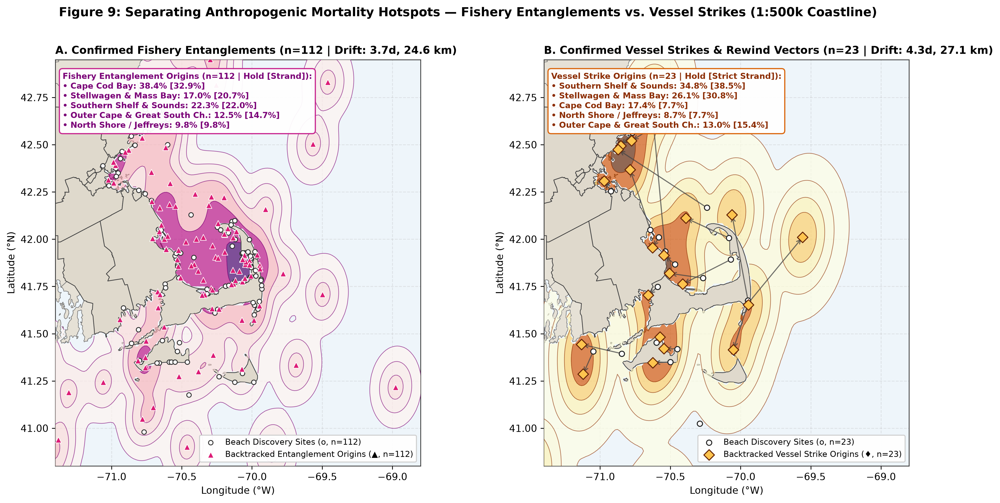

**Figure 9A (left)** maps the `112` confirmed coastal **Fishery & Gear Entanglements** (`white beach circles o` to `magenta origin triangles ▲`, `mean drift = 3.7 days, 24.6 km`; `73.2%` [`82/112`] resolve with strictly open-water tracks under `2 km Strand`). Nearly two-thirds (**`65.2%` under `Hold`, `63.4%` under `Strict Strand`**) originate in the northern fixed-gear lobster/pot and gillnet basins—led by **Cape Cod Bay (`38.4% [32.9%]`)**, **Stellwagen Bank & Massachusetts Bay (`17.0% [20.7%]`)**, and **North Shore / Jeffreys Ledge (`9.8% [9.8%]`)**—with **`22.3% [22.0%]`** on the **Southern Shelf & Sounds** and **`12.5% [14.7%]`** on the **Outer Cape & Great South Channel**.

**Figure 9B (right)** maps the `23` confirmed coastal **Vessel Strikes**, connecting each **Beach Discovery Site (`white circle o`)** directly to its **Backtracked Vessel Strike Origin (`yellow diamond ♦`)** with a grey vector arrow (`->`). Under both `Hold` and `Strict Strand`, vessel-strike origins separate into three high-traffic maritime corridors [36]:
1. **Southern Shelf, Vineyard/Nantucket Sound Ferry Corridors & Buzzards Bay (`34.8% [38.5%]`):** Eight vessel-strike origins cluster along the southern shipping and high-speed island ferry approaches (`Woods Hole`, `Vineyard Sound`, `Nantucket Sound`, and `Buzzards Bay / West Entrance of the Cape Cod Canal`).
2. **Stellwagen Bank, Boston Harbor Approaches & North Shore (`26.1% [30.8%]` Stellwagen/Mass Bay + `8.7% [7.7%]` North Shore):** Eight vessel-strike origins align with the **Boston Harbor commercial shipping lanes**, **North Shore approaches (`Salem/Gloucester`)**, and **Stellwagen Bank / Western Massachusetts Bay** [36].
3. **Cape Cod Bay (`17.4% [7.7%]`) & Outer Cape Shelf (`13.0% [15.4%]`):** Seven vessel-strike origins lie along the **Cape Cod Canal East Entrance / western Cape Cod Bay** (`Sandwich–Plymouth` corridor) and the **Outer Cape coastal shipping lane (`off Truro–Chatham`)**.

#### 3. Side-by-Side Seasonal Shift in At-Sea Cetacean Mortality (`Figure 10`)

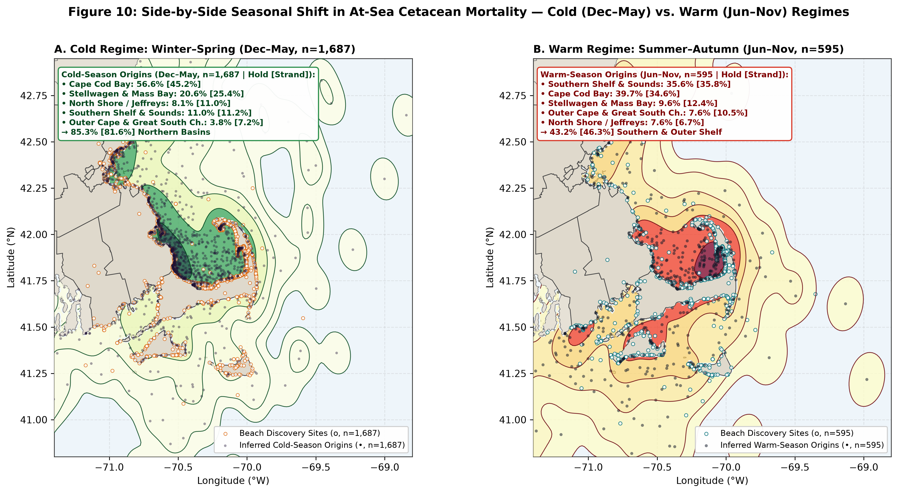

Finally, **Figure 10** compares the **Cold Regime (`Figure 10A: December–May`, `n = 1,687`)** side-by-side against the **Warm Regime (`Figure 10B: June–November`, `n = 595`)**. During the cold half of the year (`Figure 10A`), **`85.3%` (`v2 Hold`) / `81.6%` (`v2 Strict Strand`)** of all backtracked mortality concentrates in the northern basins (**`56.6% [45.2%]` Cape Cod Bay**, **`20.6% [25.4%]` Stellwagen Bank & Massachusetts Bay**, and **`8.1% [11.0%]` North Shore / Jeffreys Ledge**, versus only `11.0% [11.2%]` Southern Shelf & Sounds and `3.8% [7.2%]` Outer Cape & Great South Channel), driven by winter pelagic dolphin mortality inside Cape Cod Bay and the spring harbor porpoise gillnet spike [7]. During the warm half of the year (`Figure 10B`), as water temperatures rise and foraging whales, recreational vessels, high-speed island ferries, and commercial fishing shift southward and offshore, **`43.2%` (`v2 Hold`) / `46.3%` (`v2 Strict Strand`)** of all inferred mortality shifts into the **Southern Shelf & Sounds (`35.6% [35.8%]`)** and **Outer Cape & Great South Channel (`7.6% [10.5%]`)**, alongside **`39.7% [34.6%]` in Cape Cod Bay**, **`9.6% [12.4%]` on Stellwagen Bank & Mass Bay**, and **`7.6% [6.7%]` on the North Shore / Jeffreys Ledge**.

---

## 5. Code & Reproducibility Architecture

All Stage 2 code, datasets (including both `Engine v2` outputs and archived `v1_superseded_*` reference files), and figures are self-contained inside [`stage2_reverse_drift/`]():
1. **[`engine_v2/reverse_drift_v2.py`](engine_v2/reverse_drift_v2.py):** Core `Engine v2` physics module implementing `LandMask` (`0.001°` rasterized `1:500k` Census coastline with `50 m` buffer, cached at [`data/v2/land_mask_0p001deg_buf50m.npz`](data/v2/land_mask_0p001deg_buf50m.npz)), Bay-side vs. Sound-side shoreline water placement (`place_starts`), `dt = 30 min` sub-stepped full-segment land collision checking (`run_engine` supporting `rule='hold'` and `rule='strand'`), `classify_basin`, and central water particle selection.
2. **[`engine_v2/run_full_v2_pipeline.py`](engine_v2/run_full_v2_pipeline.py):** Executes all 7 full-dataset `Engine v2` simulation runs (`2,282` animals × `50` particles = `114,100` trajectories per run), exports all `v2` tables to [`data/v2/`](data/v2/), and generates Figures 6–10 on the `1:500,000` coastline.
3. **[`notebooks/01_drifter_cohort_and_hi_audit.ipynb`](notebooks/01_drifter_cohort_and_hi_audit.ipynb) & [`notebooks/02_lagrangian_backtracker_and_hotspots.ipynb`](notebooks/02_lagrangian_backtracker_and_hotspots.ipynb):** Complete exploratory audit (`4,831` records, town-level Collector vs. Trap Beach Index, and monthly species guild seasonality) and Lagrangian modeling notebooks.

---

## 6. References

1. Wiley, D. N., Early, G., Mayo, C. A. & Moore, M. J. Rescue and release of mass stranded cetaceans from beaches on Cape Cod, Massachusetts, USA; 1990–1999: a review of some response actions. *Aquatic Mammals* **27**(2), 162–171 (2001).
2. Bogomolni, A. L., Pugliares, K. R., Sharp, S. M., Patchett, K., Harry, C. T., LaRocque, J. M., Touhey, K. M. & Moore, M. Mortality trends of stranded marine mammals on Cape Cod and southeastern Massachusetts, USA, 2000 to 2006. *Diseases of Aquatic Organisms* **88**(2), 143–155 (2010). `https://doi.org/10.3354/dao02146`
3. Zellar, R., Pulkkinen, A., Moore, K., Rousseaux, C. S. & Reeb, D. Oceanic and atmospheric correlations to cetacean mass stranding events in Cape Cod, Massachusetts, USA. *Geophysical Research Letters* **48**(20), e2021GL093697 (2021). `https://doi.org/10.1029/2021GL093697`
4. Peltier, H., Dabin, W., Daniel, P., Van Canneyt, O., Dorémus, G., Huon, M. & Ridoux, V. The significance of stranding data as indicators of cetacean populations at sea: Modelling the drift of cetacean carcasses. *Ecological Indicators* **18**, 278–290 (2012). `https://doi.org/10.1016/j.ecolind.2011.11.014`
5. Moore, M. J., Mitchell, G. H., Rowles, T. K. & Early, G. Dead cetacean? Beach, bloat, float, sink. *Frontiers in Marine Science* **7**, 333 (2020). `https://doi.org/10.3389/fmars.2020.00333`
6. Geraci, J. R. & Lounsbury, V. J. *Marine Mammals Ashore: A Field Guide for Strandings* 2nd edn (National Aquarium in Baltimore, 2005).
7. Orphanides, C. D. Protected species bycatch estimating approaches: Estimating harbor porpoise bycatch in U.S. Northwestern Atlantic gillnet fisheries. *Journal of Northwest Atlantic Fishery Science* **42**, 55–76 (2010). `https://doi.org/10.2960/J.v42.m647`
8. Saito, T. & Rehmsmeier, M. The precision-recall plot is more informative than the ROC plot when evaluating binary classifiers on imbalanced datasets. *PLOS ONE* **10**(3), e0118432 (2015). `https://doi.org/10.1371/journal.pone.0118432`
9. Davis, J. & Goadrich, M. The relationship between Precision-Recall and ROC curves. In *Proceedings of the 23rd International Conference on Machine Learning (ICML)* 233–240 (ACM, 2006). `https://doi.org/10.1145/1143844.1143874`
10. Bergmeir, C. & Benítez, J. M. On the use of cross-validation for time series predictor evaluation. *Information Sciences* **191**, 192–213 (2012). `https://doi.org/10.1016/j.ins.2011.12.028`
11. López de Prado, M. *Advances in Financial Machine Learning* (Wiley, 2018).
12. Hoerl, A. E. & Kennard, R. W. Ridge regression: Biased estimation for nonorthogonal problems. *Technometrics* **12**(1), 55–67 (1970). `https://doi.org/10.1080/00401706.1970.10488634`
13. Dormann, C. F., Elith, J., Bacher, S., Buchmann, C., Carl, G., Carré, G. et al. Collinearity: a review of methods to deal with it and a simulation study evaluating their performance. *Ecography* **36**(1), 27–46 (2013). `https://doi.org/10.1111/j.1600-0587.2012.07348.x`
14. Breiman, L. Random Forests. *Machine Learning* **45**(1), 5–32 (2001). `https://doi.org/10.1023/A:1010933404324`
15. Fisher, A., Rudin, C. & Dominici, F. All models are wrong, but many are useful: Learning a variable's importance by studying an entire class of prediction models simultaneously. *Journal of Machine Learning Research* **20**(177), 1–81 (2019).
16. Künsch, H. R. The jackknife and the bootstrap for general stationary observations. *The Annals of Statistics* **17**(3), 1217–1241 (1989). `https://doi.org/10.1214/aos/1176347265`
17. Politis, D. N. & Romano, J. P. The stationary bootstrap. *Journal of the American Statistical Association* **89**(428), 1303–1313 (1994). `https://doi.org/10.1080/01621459.1994.10483310`
18. Pugh, D. & Woodworth, P. *Sea-Level Science: Understanding Tides, Surges, Tsunamis and Mean Sea-Level Changes* (Cambridge University Press, 2014). `https://doi.org/10.1017/CBO9781139235778`
19. Lehodey, P., Senina, I. & Murtugudde, R. A spatial ecosystem and populations dynamics model (SEAPODYM) – Modeling of tuna and tuna-like populations. *Progress in Oceanography* **78**(4), 304–318 (2008). `https://doi.org/10.1016/j.pocean.2008.06.004`
20. Lehodey, P., Murtugudde, R. & Senina, I. Bridging the gap from ocean models to population dynamics of large marine predators: A model of mid-trophic functional groups. *Progress in Oceanography* **84**(1–2), 69–84 (2010). `https://doi.org/10.1016/j.pocean.2009.09.008`
21. Overholtz, W. J. & Waring, G. T. Diet composition of pilot whales *Globicephala* sp. and common dolphins *Delphinus delphis* in the Mid-Atlantic Bight during spring 1989. *Fishery Bulletin* **89**(4), 723–728 (1991).
22. Dagestad, K.-F., Röhrs, J., Breivik, Ø. & Ådlandsvik, B. OpenDrift v1.0: A generic framework for trajectory modelling. *Geoscientific Model Development* **11**(4), 1405–1420 (2018). `https://doi.org/10.5194/gmd-11-1405-2018`
23. Daniel, P., Jan, G., Cabioc'h, F., Landau, Y. & Loiseau, E. Drift modeling of cargo containers. *Spill Science & Technology Bulletin* **7**(5–6), 279–288 (2002). `https://doi.org/10.1016/S1353-2561(02)00075-0`
24. Breivik, Ø., Allen, A. A., Maisondieu, C. & Olagnon, M. Wind-induced drift of objects at sea: The leeway field method. *Applied Ocean Research* **33**(2), 100–109 (2011). `https://doi.org/10.1016/j.apor.2011.01.005`
25. Peltier, H., Baagøe, H. J., Camphuysen, K. C. J. et al. The stranding anomaly as population indicator: The case of harbour porpoise *Phocoena phocoena* in North-Western Europe. *PLOS ONE* **8**(4), e62180 (2013). `https://doi.org/10.1371/journal.pone.0062180`
26. Peltier, H., Authier, M., Dabin, W., Dars, C., Demaret, F., Doremus, G. et al. Can modelling the drift of bycaught dolphin beachings inform the spatial distribution of bycatch? *Frontiers in Marine Science* **7**, 517 (2020). `https://doi.org/10.3389/fmars.2020.00517`
27. Nero, R. W., Cook, M., Coleman, A. T., Solangi, M. & Hardy, R. Using an ocean model to predict likely drift tracks of bottlenose dolphin carcasses. *Endangered Species Research* **21**(3), 191–203 (2013). `https://doi.org/10.3354/esr00516`
28. Gillooly, J. F., Brown, J. H., West, G. B., Savage, V. M. & Charnov, E. L. Effects of size and temperature on metabolic rate. *Science* **293**(5538), 2248–2251 (2001). `https://doi.org/10.1126/science.1061967`
29. Megyesi, M. S., Nawrocki, S. P. & Haskell, N. H. Using accumulated degree-days to estimate the postmortem interval from decomposed human remains. *Journal of Forensic Sciences* **50**(3), 618–626 (2005). `https://doi.org/10.1520/JFS2004017`
30. Okubo, A. Oceanic diffusion diagrams. *Deep-Sea Research and Oceanographic Abstracts* **18**(8), 789–802 (1971). `https://doi.org/10.1016/0011-7471(71)90046-5`
31. Metropolis, N. & Ulam, S. The Monte Carlo method. *Journal of the American Statistical Association* **44**(247), 335–341 (1949). `https://doi.org/10.1080/01621459.1949.10483310`
32. Lellouche, J.-M., Greiner, E., Bourdallé-Badie, R. et al. The Copernicus Global 1/12° Oceanic and Sea Ice GLORYS12 Reanalysis. *Frontiers in Earth Science* **9**, 698876 (2021). `https://doi.org/10.3389/feart.2021.698876`
33. Hersbach, H., Bell, B., Berrisford, P. et al. The ERA5 global reanalysis. *Quarterly Journal of the Royal Meteorological Society* **146**(730), 1999–2049 (2020). `https://doi.org/10.1002/qj.3803`
34. Rosenblatt, M. Remarks on some nonparametric estimates of a density function. *The Annals of Mathematical Statistics* **27**(3), 832–837 (1956). `https://doi.org/10.1214/aoms/1177728190`
35. Silverman, B. W. *Density Estimation for Statistics and Data Analysis* (Chapman & Hall/CRC, 1986). `https://doi.org/10.1201/9781315140919`
36. Wiley, D. N., Thompson, M., Pace, R. M. & Levenson, J. Modeling speed restrictions to mitigate lethal collisions between ships and whales in the Stellwagen Bank National Marine Sanctuary, USA. *Biological Conservation* **144**(9), 2377–2381 (2011). `https://doi.org/10.1016/j.biocon.2011.05.007`
